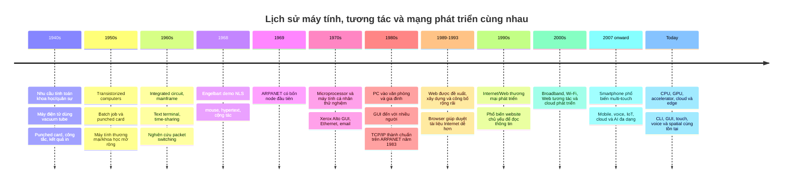
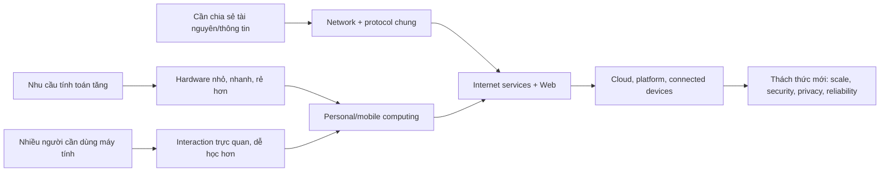
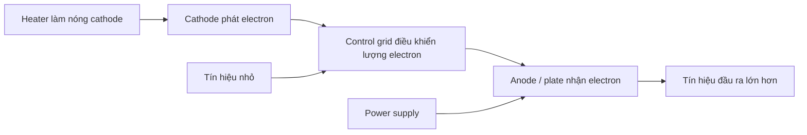

# 00 — History of Computing, HCI & the Internet

> **Ý chính:** nhu cầu tính toán, chia sẻ tài nguyên/thông tin và giúp nhiều người sử dụng máy tính đã cùng thúc đẩy ba mạch phát triển: **phần cứng**, **tương tác người–máy**, và **mạng Internet/Web**.

Chương này đi theo **trình tự thời gian**, nhưng mỗi mốc sẽ nhìn cả ba mạch để thấy chúng tác động lẫn nhau. Các mốc “thế hệ máy tính” là cách phân kỳ trong sách giáo khoa; năm bắt đầu/kết thúc có thể khác nhau và công nghệ cũ/mới thường cùng tồn tại.

## Timeline tổng quan

### Sơ đồ ghi nhớ: vấn đề → thay đổi → hệ quả

## Trước và trong thập niên 1940 — Calculation chuyển sang điện tử

### Vacuum tube bắt đầu từ đâu, do ai tạo ra?

**Vacuum tube / thermionic valve** không được phát minh ra để làm máy tính. Nó hình thành từ các thí nghiệm về bóng đèn và radio vào cuối thế kỷ 19–đầu thế kỷ 20:

1. **Thomas Edison, 1880s — quan sát “Edison effect”:** trong một bóng đèn có thể xuất hiện dòng điện giữa filament nóng và một điện cực khác. Khi đó hiện tượng này chưa tạo ra máy tính hay một ứng dụng điện tử phổ thông.
2. **John Ambrose Fleming, London, 1904 — Fleming valve/diode:** Fleming nghiên cứu hiện tượng nhiệt điện tử và tạo **diode**: dòng electron đi chủ yếu một chiều. Nó giúp phát hiện/rectify tín hiệu radio. [Science Museum Group](https://collection.sciencemuseumgroup.org.uk/objects/co467863/one-of-flemings-first-thermionic-diode-valves-1889) lưu một bóng đèn London 1889 được Fleming dùng lại trong nghiên cứu; valve hai điện cực hình thành từ thí nghiệm năm 1904.
3. **Lee de Forest, Mỹ, 1906 — Audion/triode:** thêm một **control grid** (lưới điều khiển) giữa filament và plate. Một tín hiệu yếu ở lưới có thể điều khiển dòng lớn hơn giữa các điện cực; tube vì vậy vừa detect vừa **amplify** (khuếch đại). Xem hiện vật Audion của [Smithsonian](https://americanhistory.si.edu/collections/object/nmah_1289117). Thiết kế ban đầu còn thô và cải tiến thêm qua nhiều năm.

*Hiện vật: [Audion triode, 1906 — Science Museum Group](https://collection.sciencemuseumgroup.org.uk/objects/co31098/audion-with-spherical-bulb-1906).*

Vậy nếu hỏi “ai phát minh vacuum tube?” thì câu trả lời chính xác phải nêu **nhiều bước**: Fleming tạo diode nhiệt điện tử thực dụng; de Forest phát triển Audion triode có khả năng khuếch đại; các kỹ sư sau đó cải tiến độ chân không, vật liệu và sản xuất. Không nên gán toàn bộ lịch sử cho một người.

*Hiện vật và ghi chú lịch sử: [Science Museum Group — Fleming’s thermionic valve](https://collection.sciencemuseumgroup.org.uk/objects/co467863/one-of-flemings-first-thermionic-diode-valves-1889). Bộ phận bóng đèn trong hiện vật được làm ở London năm 1889; Fleming dùng lại trong thí nghiệm dẫn tới valve hai điện cực năm 1904.*

### Vì sao tube quan trọng, và nó được dùng ở đâu?

| Chức năng | Vì sao cần? | Ứng dụng lịch sử tiêu biểu |
|---|---|---|
| **Detection / rectification** | Tách tín hiệu radio khỏi sóng mang hoặc chuyển AC thành dòng một chiều. | Radio receiver và wireless telegraphy. |
| **Amplification** | Tín hiệu nhận được quá yếu để nghe/truyền xa; tube cho phép tín hiệu nhỏ điều khiển tín hiệu lớn. | Radio, audio, telephone repeater cho đường dây dài. |
| **Oscillation / transmission** | Tạo hoặc phát tín hiệu điện từ có kiểm soát. | Radio transmitter, một số hệ thống radar và thiết bị đo. |
| **Electronic switching** | Bật/tắt dòng nhanh để biểu diễn logic nhị phân. | Early electronic calculators và computers như ENIAC. |

Trước transistor, vacuum tube phổ biến trong **radio**, **telephone amplifier/repeater**, **television**, **radar** và máy tính điện tử đời đầu. Smithsonian có hiện vật về tube cho telephone repeater, thậm chí cáp điện thoại xuyên Đại Tây Dương năm 1956 ([telephone repeater tube](https://americanhistory.si.edu/collections/object/nmah_688735)). Tube không chỉ nằm trong máy tính. Lý do các nhà thiết kế thích tube so với relay cơ điện là tube chuyển mạch không cần chờ một tiếp điểm cơ học di chuyển, nên tính toán có thể nhanh hơn nhiều.

⚠️ **Không có một “ngày vacuum tube ra đời cùng máy tính”.** Fleming valve/Audion xuất hiện đầu thế kỷ 20 cho radio và truyền thông; máy tính dùng tube trên quy mô lớn xuất hiện muộn hơn, trong bối cảnh nhu cầu tính toán khoa học/quân sự.

### Bên trong tube có gì? Vì sao nó khuếch đại được?

Trong thermionic tube cơ bản, **cathode** được nung nóng để phát electron; **anode/plate** hút electron qua vùng chân không. Thêm **control grid** vào giữa sẽ điều khiển dòng electron bằng một điện áp nhỏ. Như vậy, tín hiệu nhỏ ở grid có thể điều khiển năng lượng lớn hơn từ nguồn cấp—đó là amplification. Vacuum tube không tự tạo năng lượng; nó điều khiển năng lượng lấy từ power supply.

Diode có cathode + anode nên thường dùng để rectification/detection; triode thêm grid để điều khiển dòng. Trong computer logic, mạch được thiết kế để tube làm switch theo ngưỡng, biểu diễn trạng thái 0/1. Đây là giải thích mô hình; các circuit thực tế có nhiều cấu hình hơn.

Trước máy tính điện tử, con người dùng **mechanical calculator**, biểu mẫu giấy, **punched card** (thẻ đục lỗ) và cả những nhân viên làm phép tính thủ công. Bài toán khoa học, chính phủ và quân sự đòi hỏi lặp lại rất nhiều phép tính, vượt quá tốc độ con người.

**ENIAC (Electronic Numerical Integrator and Computer)** được xây dựng cho phòng thí nghiệm đạn đạo của quân đội Mỹ để tính bảng bắn pháo. Máy dùng **vacuum tube** (đèn điện tử chân không), được giới thiệu năm 1946. Đây là máy điện tử số quy mô lớn, có thể lập trình, nhưng thiết kế ban đầu **chưa phải stored-program computer** theo nghĩa hiện đại. Cẩn thận với câu “ENIAC là máy tính đầu tiên” vì câu trả lời phụ thuộc định nghĩa máy tính nào.

**Ai và ở đâu?** John W. Mauchly đề xuất hướng dùng electronics để tăng tốc tính quỹ đạo; kỹ sư J. Presper Eckert thiết kế nhiều phần cứng cốt lõi. Họ làm tại **Moore School of Electrical Engineering, University of Pennsylvania, Philadelphia**, theo hợp đồng của US Army Ordnance/Ballistics Research Laboratory ở Aberdeen, Maryland. Đại úy/mathematician **Herman Goldstine** là đầu mối quân đội quan trọng. Dự án được ký năm 1943; máy công khai năm 1946. Xem [biên niên sử ENIAC của University of Pennsylvania](https://almanac.upenn.edu/archive/v42/n18/eniac.html) và [hiện vật ENIAC của Computer History Museum](https://www.computerhistory.org/revolution/digital-logic/12/271/1342).

*Ảnh và lịch sử: [Computer History Museum — ENIAC](https://www.computerhistory.org/tdih/may/17/). Dự án bắt đầu năm 1943, ENIAC được giới thiệu tháng 2/1946.*

### ENIAC dùng tube thế nào trong công việc thật?

- Có khoảng **18,000 vacuum tubes**, nặng khoảng **30 tons**, chiếm hơn **1,000 square feet**; con số thay đổi đôi chút giữa các mô tả/phiên bản.
- Tube trong logic đóng vai trò electronic switch: trạng thái mạch được diễn giải thành bit/logic; hàng nghìn linh kiện phối hợp để tính số.
- Chương trình ban đầu được thiết lập bằng patch cables và switches trên panel. Đổi chương trình có thể cần cấu hình lại dây, nên “programmable” thời đó chưa có nghĩa bấm nút tải app.
- Workload nổi tiếng là ballistics calculations; sau đó máy còn được dùng cho các phép tính khoa học khác. Khi chuyển đến Aberdeen, nó tiếp tục vận hành đến năm 1955.
- Tube tiêu thụ điện và tỏa nhiệt đáng kể; nhiều linh kiện hơn cũng làm tăng việc bảo trì. Tuy nhiên, đừng tưởng ENIAC cứ vài phút là hỏng: thiết kế và bảo trì đã giúp máy chạy được các phép tính lớn; chính độ phức tạp, nhiệt, công suất và công sửa chữa khiến giới nghiên cứu tìm cách làm tốt hơn.

🖼️ Xem [ảnh ENIAC và mô tả hiện vật của Computer History Museum](https://www.computerhistory.org/revolution/digital-logic/12/271/1342).

**User interaction:** người vận hành cài dây/công tắc, dùng băng giấy hoặc punched card để nhập dữ liệu, rồi chờ kết quả in/ghi ra. Đây là **batch processing**: chuẩn bị việc → nộp cho máy → đợi kết quả; chưa có phản hồi tức thì như app ngày nay.

## 1947–1959 — Transistor giải bài toán kích thước và độ bền

**Ở đâu?** Bell Telephone Laboratories (Bell Labs), Murray Hill, New Jersey, Mỹ. Năm 1945, William Shockley tổ chức nhóm **solid-state physics** nhằm tìm thiết bị bán dẫn thay các vacuum tube và electromechanical switch thiếu tin cậy trong mạng điện thoại Bell.

**Ai?** Ngày 16/12/1947, nhà vật lý lý thuyết **John Bardeen** và nhà vật lý thực nghiệm **Walter Brattain** tạo được point-contact transistor trên germanium. Shockley là trưởng nhóm, thúc đẩy hướng nghiên cứu và sau đó phát triển **junction transistor** bền/khả thi hơn; cả ba nhận Nobel Vật lý năm 1956 cho công trình về semiconductor.

Mục tiêu ban đầu không chỉ là “làm máy tính nhỏ”: Bell Labs muốn linh kiện thay tube và electromechanical switch trong hệ thống điện thoại—những nơi cần khuếch đại/chuyển tín hiệu liên tục. [Computer History Museum ghi lại quá trình nghiên cứu này](https://www.computerhistory.org/siliconengine/invention-of-the-point-contact-transistor/).

Transistor có thể khuếch đại/chuyển mạch mà không cần bóng đèn lớn và nóng như vacuum tube. Nhưng transistor đầu tiên vẫn mỏng manh, khó sản xuất; vật liệu, silicon processing và quy trình chế tạo phải tiến bộ thêm. Vì vậy việc thay tube diễn ra từng bước.

**Vì sao quan trọng?** Độ bền cao hơn, kích thước và điện năng thấp hơn giúp máy tính nhỏ dần và dễ triển khai hơn. Hai công nghệ không đổi chỗ ngay lập tức; quá trình chuyển đổi diễn ra qua nhiều năm.

**Dùng thực tế ở đâu?** Dần xuất hiện trong radio dùng pin và thiết bị điện tử tiêu dùng, rồi máy tính. Prototype transistorized computer tại **University of Manchester, Anh** được trình diễn năm 1953; Bell Labs phát triển **TRADIC** cho **US Air Force** năm 1954; phiên bản bay hỗ trợ navigation/bombing-control trên máy bay C-131. Đây là ví dụ transistor được thúc đẩy bởi nhu cầu giảm kích thước/điện năng, kể cả trong môi trường hàng không.

🖼️ Hình và timeline: [Bell Labs transistor — Computer History Museum](https://www.computerhistory.org/siliconengine/invention-of-the-point-contact-transistor/) · [Transistorized computers — Computer History Museum](https://www.computerhistory.org/siliconengine/transistorized-computers-emerge/).

## 1950s–1960s — Mainframe, batch processing và time-sharing

**Mainframe** phục vụ tác vụ khoa học, kinh doanh và chính phủ. Nhiều công việc ban đầu vẫn chạy theo lô (**batch job**). Khi nhiều người cùng cần dùng một máy trung tâm đắt tiền, **time-sharing** chia thời gian xử lý thành lát nhỏ để người dùng thao tác qua các **terminal**.

Ví dụ sớm: **CTSS (Compatible Time-Sharing System)** tại MIT và **PLATO II** tại University of Illinois. Terminal có thể là teletype/máy in rồi dần là màn hình chữ + bàn phím; user nhập lệnh và nhận kết quả dạng text. Nó có tính tương tác nhưng chưa phải giao diện đồ họa point-and-click. Đây là liên hệ quan trọng giữa hạ tầng và UI: máy trung tâm đắt dẫn đến nhu cầu scheduling, multi-user access và remote terminal.

## 1947–1971 — Semiconductor tiến đến microprocessor

| Mốc | Điều gì thay đổi? | Vì sao đáng nhớ? |
|---|---|---|
| 1947: transistor được trình diễn | Linh kiện bán dẫn dùng để chuyển mạch/khuếch đại | Nhỏ và tiết kiệm điện hơn vacuum tube. |
| 1958–1959: các hướng phát triển integrated circuit | Nhiều linh kiện được tạo/kết nối trên nền bán dẫn | Giảm lắp ráp rời rạc; Jack Kilby và Robert Noyce có những đóng góp riêng, quan trọng cho IC. |
| 1960s: MOS và planar manufacturing tiến bộ | Thiết bị bán dẫn dày đặc, chế tạo ổn định hơn | Làm tăng khả năng tích hợp và sản xuất số lượng lớn. |
| 1971: Intel 4004 ra mắt | Chức năng CPU được tích hợp trên một microprocessor thương mại | Giúp hệ thống lập trình được trở nên nhỏ và phổ biến hơn. |

Mẫu hình lịch sử là **integration**: giảm số linh kiện phải nối riêng, tăng mật độ và cải thiện sản xuất để giảm chi phí cho mỗi phép tính. Không có một phát minh đơn lẻ nào ngay lập tức tạo ra máy tính hiện đại.

| Công nghệ | “Khối xây dựng” | Lợi ích so với trước | Giới hạn/chi phí còn lại |
|---|---|---|---|
| Vacuum tube | Linh kiện điện tử rời, nhiều kích cỡ | Switching/amplification nhanh hơn relay cơ điện | Nóng, tốn điện/diện tích, cần bảo trì. |
| Transistor | Linh kiện bán dẫn nhỏ | Giảm kích thước, điện năng; bền hơn khi công nghệ trưởng thành | Vẫn phải nối nhiều linh kiện rời để làm mạch lớn. |
| Integrated circuit | Nhiều linh kiện + interconnect trên chip | Giảm mối nối rời, dễ nhân rộng khi process tốt | Ban đầu đắt; phụ thuộc yield, thiết kế và fab. |
| Microprocessor | CPU logic trên một chip | Một bộ xử lý lập trình lại được cho nhiều sản phẩm | Cần memory/I/O và phần cứng phụ trợ; CPU chưa phải cả máy tính. |

### Integrated circuit (IC): ý tưởng và con đường sản xuất

Cuối thập niên 1950, vấn đề là một mạch transistor gồm nhiều linh kiện rời sẽ ngày càng khó nối, tốn diện tích và dễ lỗi khi tăng độ phức tạp.

- **Jack Kilby tại Texas Instruments (Dallas, Texas)** trình diễn “solid circuit” năm 1958, cho thấy active và passive components có thể cùng nằm trên vật liệu bán dẫn.
- **Robert Noyce tại Fairchild Semiconductor (Mountain View, California)** năm 1959 mô tả cấu trúc monolithic IC với interconnect có thể sản xuất tốt hơn ở quy mô lớn; ý tưởng này dựa trên **planar process** do **Jean Hoerni** phát triển.
- Đây là các đóng góp độc lập, bổ sung nhau; cách gọi “một người duy nhất phát minh IC” làm mất phần lịch sử và kỹ thuật sản xuất.

**Vì sao IC chưa lập tức rẻ?** Các IC đầu tiên đắt hơn mạch rời. Tài trợ quân sự/hàng không vũ trụ chấp nhận chi phí cao vì khối lượng, thể tích và điện năng rất quan trọng. Khi manufacturing yield, photolithography và sản lượng tăng, giá giảm và IC lan sang máy tính/điện tử thương mại.

🖼️ Xem [timeline IC, MOS và manufacturing — Computer History Museum](https://www.computerhistory.org/siliconengine/timeline/).

### Microprocessor: CPU trên chip, xuất phát từ đơn hàng calculator

Microprocessor không xuất hiện đơn giản vì ai đó quyết định “đưa CPU vào PC”. **Busicom**, một hãng calculator Nhật Bản, đặt Intel thiết kế một bộ chip custom cho calculator năm 1969. Intel engineer **Ted Hoff** và **Stan Mazor** đề xuất kiến trúc linh hoạt hơn: một CPU nhỏ lập trình được cùng các chip hỗ trợ thay vì một mạch logic riêng cho mỗi model. **Federico Faggin** dẫn đầu implementation/silicon design; kỹ sư Busicom **Masatoshi Shima** đóng góp vào dự án.

Intel **4004** được giới thiệu năm 1971: CPU 4-bit, khoảng **2,300 transistors**, nằm trên một chip nhưng là một phần của **MCS-4 chipset** (cần ROM/RAM và chip hỗ trợ để thành hệ thống). Tính lập trình lại làm thay đổi economics của sản phẩm: nhà sản xuất có thể thay đổi hành vi qua software/firmware thay vì thiết kế lại toàn bộ logic phần cứng.

Sau đó, giá chip và kích thước giảm đủ để thúc đẩy kit/hobbyist systems như **Altair 8800 (1975)**, rồi các máy hướng tới người dùng rộng hơn như **Apple II**, **TRS-80** và **Commodore PET (1977)**. IBM PC (1981) giúp PC trở thành công cụ kinh doanh rõ rệt hơn. Mốc “thế hệ 4 = microprocessor” là tóm tắt giáo khoa; ngoài thực tế các giai đoạn chồng lấn.

Nguồn/ảnh: [Intel 4004 — Computer History Museum](https://www.computerhistory.org/siliconengine/microprocessor-integrates-cpu-function-onto-a-single-chip/) · [Altair 8800 — Computer History Museum](https://www.computerhistory.org/revolution/input-output/14/352/1696).

🖼️ Xem [The Silicon Engine timeline — Computer History Museum](https://www.computerhistory.org/siliconengine/timeline/): timeline và hình ảnh về transistor, IC, MOS, microprocessor.

## 1960s–1970s — Tương tác chuyển từ “nộp việc” sang đối thoại và trỏ chuột

### CLI và text terminal

**CLI (Command-Line Interface)** là cách nhập lệnh dạng chữ. CLI vẫn rất hữu ích cho automation, remote administration và các tác vụ lặp lại; GUI xuất hiện không làm CLI biến mất. Trước cả terminal tương tác, người dùng đã có punched card và paper tape, nên không có một năm duy nhất mà “CLI bắt đầu”.

**Vì sao CLI tồn tại lâu?** Khi máy tính đắt và nhiều user dùng chung mainframe, text terminal truyền ít dữ liệu hơn đồ họa và phù hợp với thiết bị đơn giản. Command cũng có thể lưu thành script, chạy lặp lại và quản trị từ xa. Nhược điểm là user phải nhớ command, syntax, path và error message; một lỗi gõ có thể làm sai thao tác.

### Engelbart demo năm 1968

**Mouse được tạo ra ở đâu?** Douglas Engelbart hình thành ý tưởng pointing device đầu thập niên 1960; kỹ sư **Bill English** chế tạo prototype tại **Stanford Research Institute (SRI), California**, khoảng năm 1963. Vỏ gỗ và hai bánh xe vuông góc đổi chuyển động tay thành hướng di chuyển con trỏ. Tên “mouse” được dùng vì dây phía sau trông như đuôi chuột. Xem [hiện vật và lịch sử mouse](https://www.computerhistory.org/revolution/story/350).

Năm 1968, nhóm Engelbart tại SRI trình diễn **NLS (oN-Line System)**. NLS có mouse, hypertext links, cộng tác chỉnh sửa và videoconferencing. Điểm đáng nhớ không chỉ là con chuột: máy tính được trình bày như công cụ giúp con người cộng tác và kết nối ý tưởng. Đây là hệ thống nghiên cứu được ARPA tài trợ, chưa phải giao diện thương mại đại chúng.

🖼️ [The Mother of All Demos — Computer History Museum](https://www.computerhistory.org/timeline/1968/) có tư liệu lịch sử về buổi demo NLS.

### Xerox Alto, 1973 — GUI trong môi trường nghiên cứu

Xerox Alto kết hợp bitmap display, mouse, windows, icons, networking và soạn thảo WYSIWYG trong một hệ thống nghiên cứu personal computing. Alto có ảnh hưởng lớn nhưng **không phải sản phẩm bán đại trà**. Xerox Star (1981), Apple Lisa (1983), Macintosh (1984) và các hệ thống sau đó đưa các ý tưởng GUI đến người dùng thương mại theo những cách khác nhau.

**GUI (Graphical User Interface)** cho người dùng thấy đối tượng và hành động trực quan, giảm việc phải nhớ cú pháp lệnh cho thao tác thông thường. Đổi lại, thiết kế GUI cần quan tâm khả năng khám phá, accessibility, diện tích màn hình, tính nhất quán và độ chính xác khi nhập.

**Vì sao GUI đi từ research lab ra thị trường?** Xerox PARC (thành lập năm 1970) nghiên cứu “office of the future”, personal computing và chia sẻ tài liệu. Alto (1973) là platform thử nghiệm—mouse, display đồ họa, Ethernet, file server và WYSIWYG cùng giải quyết một workflow văn phòng. Giá cao khiến Alto không thành PC đại chúng. Xerox Star (1981), Apple Lisa (1983) và Macintosh (1984) thương mại hóa một số ý tưởng theo thiết kế/giá khác nhau. GUI không chỉ “dễ hơn”: nó cần hardware có bitmap display, memory và pointing device đủ dùng.

🖼️ Tham khảo hiện vật: [Xerox Alto](https://www.computerhistory.org/revolution/story/347) và [Macintosh at 40](https://computerhistory.org/exhibits/hello-the-mac-at-40/).

*Ảnh và các ví dụ GUI: [Xerox Alto — Computer History Museum](https://www.computerhistory.org/revolution/story/347).*

## 1960s–1980s — Từ packet switching đến Internet

### Vì sao có ARPANET?

ARPA tài trợ nghiên cứu để kết nối máy tính và chia sẻ tài nguyên xử lý giữa các cơ sở nghiên cứu. Một bài toán kỹ thuật là làm sao nhiều máy khác nhau, dùng mạng khác nhau, có thể trao đổi dữ liệu. **Packet switching** chia dữ liệu thành packet để chuyển tiếp qua mạng; cách này giúp chia sẻ đường truyền linh hoạt và cho phép tìm đường qua các node khả dụng.

**Bối cảnh thực tế:** cuối thập niên 1960, máy tính mainframe rất đắt, mỗi cơ sở nghiên cứu có một hệ thống riêng. Kết nối chúng giúp researcher truy cập host/software/data từ xa và tránh mỗi nơi phải tự mua mọi năng lực. ARPA ký với Bolt Beranek and Newman (BBN) để chế tạo **IMP (Interface Message Processor)**—một kiểu early packet switch/router. Bốn node đầu hoạt động năm 1969. ARPANET ban đầu dùng leased telephone lines; wireless/radio/satellite packet networks là các hướng nghiên cứu liên quan nhưng không nên tưởng tượng rằng ARPANET đầu tiên chính là mạng radio tự chữa lành.

⚠️ **Đính chính giai thoại phổ biến:** “ARPANET được tạo ra để quân đội Mỹ liên lạc sau một cuộc tấn công hạt nhân” là cách kể đơn giản hóa, không phải lời giải thích đầy đủ cho nguồn gốc ARPANET. Các động lực ban đầu gồm chia sẻ tài nguyên và kết nối máy tính nghiên cứu. Tính chịu lỗi là lợi ích của mạng packet phân tán và thuộc bối cảnh nghiên cứu rộng hơn; đừng học thuộc chuyện chiến tranh hạt nhân như nguồn gốc đã được chứng minh duy nhất.

Năm 1969, bốn node đầu kết nối UCLA, Stanford Research Institute (SRI), UC Santa Barbara và University of Utah. Ngày 29/10, thông điệp host-to-host đầu tiên được gửi thử là “LO”: hệ thống lỗi trước khi hoàn tất từ “LOGIN”. Email xuất hiện không lâu sau đó và trở thành một ứng dụng mạng quan trọng ban đầu.

**1971 — network email:** kỹ sư **Ray Tomlinson** tại BBN chỉnh sửa chương trình mail để gửi message giữa hai máy qua ARPANET; ông chọn ký tự `@` để phân tách user và host. Lúc ấy cộng đồng dùng ARPANET vẫn nhỏ, nhưng email nhanh chóng giải quyết nhu cầu cộng tác lệch múi giờ/không cần online cùng lúc. Theo [Computer History Museum](https://www.computerhistory.org/timeline/networking-the-web/), đến 1973 email đã chiếm phần lớn traffic trên ARPANET.

*Ảnh, bản đồ bốn node và sơ đồ packet network: [DARPA — ARPANET history](https://www.darpa.mil/news/features/arpanet).*

### TCP/IP giúp các mạng “nói chuyện” với nhau

Sau khi nối được một số máy, thách thức tiếp theo là kết nối **nhiều mạng khác công nghệ**. **TCP/IP (Transmission Control Protocol / Internet Protocol)** là bộ giao thức chung cho việc **internetworking**. Ngày 1/1/1983, ARPANET chuyển sang TCP/IP; đây là cột mốc quan trọng trong quá trình hình thành Internet. Internet là **network of networks**, không phải một sợi cáp hay một website duy nhất.

**Vì sao phải có TCP/IP?** Cần một protocol suite có thể chạy trên nhiều network technology. IP lo địa chỉ và chuyển packet giữa các mạng; TCP cung cấp byte stream tin cậy cho ứng dụng cần thứ tự/retransmission. Không phải mọi traffic đều phải dùng TCP—UDP phục vụ trường hợp datagram nhẹ hơn. Đây là kiến trúc nhiều lớp: ứng dụng không cần biết packet đã đi qua hãng router nào.

**Ai phát triển?** Vint Cerf và Robert Kahn cùng thiết kế hướng internetworking; công trình được thử nghiệm, chỉnh sửa và triển khai qua nhiều năm. DARPA ghi nhận việc chuyển ARPANET sang TCP/IP vào tháng 1/1983. Sau đó NSFNET, trường đại học, tổ chức và nhà cung cấp thương mại góp phần mở rộng Internet—không có một cá nhân hay một ngày duy nhất “bật Internet toàn cầu”. Xem [DARPA: ARPANET đến Internet](https://www.darpa.mil/news/features/arpanet).

**1983 — DNS giải bài toán nhớ tên:** khi số host tăng, giữ danh sách host/address tập trung không còn scale tốt. **Paul Mockapetris** thiết kế Domain Name System: một cây tên phân tán, được chia thành zone/name server và có resolver/cache. Tên như `example.org` tiện cho con người; địa chỉ IP vẫn dùng cho packet routing. Mô tả ban đầu được ghi trong [RFC 882 (1983)](https://www.rfc-editor.org/rfc/rfc882.html) và [RFC 883](https://www.rfc-editor.org/rfc/rfc883.html).

**1986–1995 — từ research backbone sang thương mại:** NSFNET kết nối các trung tâm siêu máy tính với cộng đồng nghiên cứu và trở thành backbone quan trọng của Mỹ. Mạng này tăng từ khoảng 2,000 máy vào năm 1986 lên hơn 2 triệu vào 1993; sau khi thương mại hóa Internet tăng nhanh, NSFNET backbone ngừng hoạt động năm 1995 và traffic chuyển sang provider thương mại. Xem [National Science Foundation: Internet history](https://www.nsf.gov/impacts/internet).

## 1970s–1990s — Personal computer, LAN và Web

Microprocessor giúp những máy nhỏ hơn trở nên khả thi về chi phí. **PC (Personal Computer)** đưa máy tính đến bàn làm việc, trường học và gia đình. **Ethernet** và **LAN (Local Area Network)** kết nối máy trong phạm vi gần; email, chia sẻ file và máy in đã hữu ích trước khi Web xuất hiện.

**PC không ra đời chỉ vì chip nhỏ hơn:** cần cả giá đủ thấp, bộ nhớ/storage, màn hình, keyboard, phần mềm, distribution và người mua hiểu máy giúp được việc gì. Altair 8800 là kit/hobbyist machine—người dùng nhiều khi phải gạt switch để nạp lệnh. Apple II, TRS-80, Commodore PET mang trải nghiệm hoàn chỉnh hơn. Sau đó IBM PC tương thích rộng và phần mềm business làm thị trường văn phòng tăng nhanh.

**Một bước chuyển của UI:** Altair 8800 (1975) nhắm tới hobbyist và ban đầu tương tác qua switch/đèn báo; Apple II (1977) thêm màu, keyboard và BASIC; TRS-80 bán qua mạng lưới cửa hàng Radio Shack. Các máy này đưa computing gần hơn với trường học và hộ gia đình. IBM PC (1981) được tổ chức mua cho công việc văn phòng, tạo hệ sinh thái phần cứng/phần mềm tương thích rộng. “PC đầu tiên” phụ thuộc định nghĩa: kit, microcomputer và mass-market PC không hoàn toàn cùng nghĩa.

### Internet khác World Wide Web

- **Internet:** hạ tầng mạng liên kết toàn cầu và hệ giao thức giúp các mạng trao đổi dữ liệu.
- **World Wide Web (WWW / Web):** một hệ thống thông tin chạy trên Internet, dùng tài nguyên liên kết và các công nghệ như URL, HTTP, HTML, server và browser.
- Email, file transfer, remote login và DNS là dịch vụ Internet nhưng **không phải Web**.

Tháng 3/1989, Tim Berners-Lee đề xuất tại CERN một hệ thống quản lý thông tin để nhà nghiên cứu chia sẻ tài liệu qua nhiều máy tính/tổ chức. Đến năm 1990, các thành phần Web và browser/server đầu tiên được triển khai; website đầu tiên chạy tại CERN. Tháng 4/1993, CERN công bố phần mềm Web để cộng đồng sử dụng, góp phần thúc đẩy Web lan rộng.

**Lý do Web hình thành:** CERN có các nhóm nghiên cứu quốc tế, dùng máy và phần mềm khác nhau; tài liệu và quan hệ giữa tài liệu khó giữ đồng bộ. Hypertext đã có trước đó, nhưng Berners-Lee ghép **identifier (URL), protocol (HTTP), markup (HTML), server và browser** thành một hệ thống đơn giản để liên kết tài liệu qua Internet. Mỗi thành phần có nhiệm vụ riêng; Web không phải một app duy nhất.

*Ảnh và lịch sử: [The birth of the Web — CERN](https://home.cern/science/computing/the-birth-of-the-web). Có thể xem [website đầu tiên đã phục dựng](https://info.cern.ch/).*

**Ý nghĩa:** trước Web, người dùng thường phải biết công cụ và địa chỉ riêng cho từng dịch vụ. Hyperlink và browser giúp điều hướng tài liệu giữa các hệ thống dễ hơn. Web không tạo ra Internet; nó làm một ứng dụng quan trọng trên Internet dễ tiếp cận hơn.

**Vì sao Web bùng lên khoảng 1993?** Web không phải hệ thống link duy nhất—Gopher, Viola và các công cụ khác cũng tồn tại. Năm 1993, **NCSA Mosaic** do Marc Andreessen và Eric Bina phát triển giúp trang có hình ảnh nằm cùng văn bản, chạy trên các máy phổ thông và dễ cài hơn với người không chuyên. CERN công bố Web software rộng rãi; hai việc này cùng làm Web dễ dùng và dễ mở rộng. Đọc [timeline Networking & the Web của Computer History Museum](https://www.computerhistory.org/timeline/networking-the-web/) để xem Web cạnh tranh với Gopher và Mosaic thay đổi trải nghiệm ra sao.

## 1990s–2000s — Web trở nên tương tác

Web phát triển từ những trang chủ yếu do nhà xuất bản viết thành dịch vụ có server/database, search, thương mại điện tử, forum, blog, mạng xã hội và nội dung do người dùng tạo. **Web 1.0 / Web 2.0** là cách gọi phổ biến để ghi nhớ thay đổi trong cách dùng Web, **không phải phiên bản giao thức chính thức**. **Web 3.0** cũng không phải “version 3” đã được chuẩn hóa; thuật ngữ có thể chỉ semantic web, blockchain/decentralization hoặc AI tùy ngữ cảnh.

Broadband và Wi-Fi giúp truy cập hàng ngày tốt hơn; laptop rồi điện thoại giúp người dùng kết nối di động. **Server virtualization** và hosted platform giúp tổ chức phân bổ tài nguyên linh hoạt hơn. **Cloud computing** phát triển theo hướng cung cấp compute, storage và managed service qua mạng theo nhu cầu.

## Từ 2007 đến nay — Touch, mobile, cloud và giao diện mới

### Touchscreen ra đời trước iPhone

Năm **1965**, kỹ sư **E. A. Johnson** tại **Royal Radar Establishment, Malvern, Anh** mô tả capacitive touch display nhằm hỗ trợ điều khiển không lưu: người vận hành cần chọn vị trí/đối tượng trực tiếp thay vì thao tác qua nhiều bước trung gian. Nghiên cứu touch tiếp tục trong các thập niên sau; ví dụ CERN từng dùng màn hình cảm ứng để điều khiển hệ thống nghiên cứu. Năm 1992, **IBM Simon** là một trong những điện thoại có touchscreen thương mại sớm. Xem mốc từ [Library of Congress](https://www.loc.gov/everyday-mysteries/categories/technology/item/how-does-a-touch-screen-work/).

iPhone được Apple giới thiệu năm **2007** với màn hình **multi-touch** lớn và phần mềm điều khiển bằng ngón tay; đây là bước phổ biến hóa và tích hợp rất thành công, không phải phát minh ra touch. Điểm thay đổi là ghép touch với mobile web, email, media, sensor, wireless networking và một giao diện đủ dùng hằng ngày. [Thông cáo ra mắt iPhone năm 2007 của Apple](https://www.apple.com/uk/newsroom/2007/01/09Apple-Reinvents-the-Phone-with-iPhone/) mô tả các chức năng được kết hợp trong thiết bị.

Touch UI thay đổi giả định thiết kế: không còn chuột chính xác, ngón tay che nội dung, thiết bị xoay được, bàn phím ảo chiếm màn hình, và latency/network/battery trở thành một phần trải nghiệm.

Voice assistant, conversational UI và generative AI giúp tương tác bằng ngôn ngữ tự nhiên phổ biến hơn. **AR (Augmented Reality)** và **VR (Virtual Reality)** mở ra spatial interface. Các kiểu này bổ sung cho bàn phím, CLI và GUI chứ không xóa bỏ chúng. Mỗi kiểu lại đặt yêu cầu hạ tầng về identity, network, compute, latency, privacy, accessibility và security.

Hạ tầng ngày nay kết hợp CPU, GPU/accelerator; thiết bị cá nhân, data center, cloud và edge; virtualization, container; mạng có dây/không dây; cùng security và observability xuyên suốt.

## 5 điều cần nhớ cho IE101

1. **Hardware tiến hóa để giải các giới hạn:** vacuum tube → transistor → IC → microprocessor; độ bền, mật độ, điện năng và chi phí cải thiện dần theo thời gian.
2. **Interaction thay đổi theo người dùng và workload:** punched card/batch → text terminal/CLI → mouse/GUI → touch/mobile → voice/spatial. Các cách cũ vẫn được dùng.
3. **Internet ≠ Web:** Web là hệ thống thông tin chạy trên Internet.
4. **ARPANET thường bị kể sai nguồn gốc:** nhớ resource sharing, research networking, packet switching, interoperability; đừng giản lược thành chuyện sống sót sau tấn công hạt nhân.
5. Với mỗi mốc, ghi nhớ **problem → invention → trade-off / next problem**. Ví dụ: các mạng không tương thích → TCP/IP kết nối mạng → nhu cầu tìm/chia sẻ thông tin dễ dàng hơn → Web.

## Bảng ôn nhanh: vấn đề → thay đổi → hệ quả

| Áp lực lịch sử | Thay đổi | Hệ quả / thách thức mới |
|---|---|---|
| Tính toán thủ công quá chậm | Electronic computing | Nhanh hơn nhưng máy cồng kềnh, đắt, cần chuyên gia vận hành. |
| Vacuum tube lớn, nóng, dễ hỏng | Transistor và semiconductor manufacturing | Máy nhỏ hơn; nhu cầu tích hợp linh kiện tiếp tục tăng. |
| Nhiều linh kiện rời tốn chi phí lắp ráp | IC và microprocessor | PC và thiết bị nhúng trở nên khả thi ở quy mô lớn. |
| Batch chậm, khó tiếp cận | Terminal, mouse, GUI | Tương tác trực tiếp hơn; nảy sinh bài toán usability/accessibility. |
| Máy và mạng nghiên cứu rời rạc | ARPANET, packet switching, TCP/IP | Các mạng liên kết được; phát sinh yêu cầu routing/security/governance. |
| Khó tìm thông tin trên Internet | Web links, URL, HTTP, HTML, browser | Người dùng dễ truy cập hơn; phát sinh thách thức privacy, scale, reliability. |
| Cần truy cập ở mọi nơi và tương tác tự nhiên | Mobile, broadband, cloud, voice | Luôn kết nối; cần quản lý identity, latency, dữ liệu và privacy. |

## Nguồn tư liệu và hình ảnh

- [Fleming thermionic valve — Science Museum Group](https://collection.sciencemuseumgroup.org.uk/objects/co467863/one-of-flemings-first-thermionic-diode-valves-1889) — hiện vật diode valve, bối cảnh nghiên cứu và mốc 1904.
- [De Forest Audion — Science Museum Group](https://collection.sciencemuseumgroup.org.uk/objects/co31098/audion-with-spherical-bulb-1906) và [Smithsonian](https://americanhistory.si.edu/collections/object/nmah_1289117) — triode 1906, vai trò khuếch đại trong radio/telephone.
- [ENIAC — University of Pennsylvania](https://almanac.upenn.edu/archive/v42/n18/eniac.html) và [Computer History Museum](https://www.computerhistory.org/revolution/digital-logic/12/271/1342) — mục đích, nhóm thiết kế, địa điểm và hiện vật.
- [Transistor — Computer History Museum](https://www.computerhistory.org/siliconengine/invention-of-the-point-contact-transistor/) — Bell Labs, Bardeen/Brattain/Shockley và lý do thay tube.
- [Transistorized computers — Computer History Museum](https://www.computerhistory.org/siliconengine/transistorized-computers-emerge/) — Manchester prototype, TRADIC và ứng dụng hàng không.
- [Integrated circuit timeline — Computer History Museum](https://www.computerhistory.org/siliconengine/timeline/) — Kilby, Noyce, Hoerni, planar process và động lực hàng không vũ trụ.
- [Intel 4004 — Computer History Museum](https://www.computerhistory.org/siliconengine/microprocessor-integrates-cpu-function-onto-a-single-chip/) — Busicom, nhóm thiết kế, chip CPU và các thành phần hỗ trợ.
- [DNS nguyên bản — RFC 882 và RFC 883](https://www.rfc-editor.org/rfc/rfc882.html) — chuẩn hóa domain tree, resolver và name server năm 1983.
- [NSFNET và Internet thương mại — NSF](https://www.nsf.gov/impacts/internet) — backbone nghiên cứu, tăng trưởng mạng và mốc 1995.
- [Email trên ARPANET — Computer History Museum](https://www.computerhistory.org/timeline/networking-the-web/) — Ray Tomlinson, địa chỉ `@` và vai trò email ban đầu.
- [Mouse — Computer History Museum](https://www.computerhistory.org/revolution/story/350) — Engelbart, prototype và sự phát triển của pointing device.
- [Touchscreen — Library of Congress](https://www.loc.gov/everyday-mysteries/categories/technology/item/how-does-a-touch-screen-work/) — E. A. Johnson, mốc 1965–67 và ứng dụng.
- [iPhone ra mắt năm 2007 — Apple Newsroom](https://www.apple.com/uk/newsroom/2007/01/09Apple-Reinvents-the-Phone-with-iPhone/) — multi-touch, mobile phone, Web/email trong một thiết bị.
- [Networking & the Web timeline — Computer History Museum](https://www.computerhistory.org/timeline/networking-the-web/) — time-sharing, ARPANET, Web, Mosaic và các đối thủ ban đầu.
- [The Mother of All Demos — Computer History Museum](https://www.computerhistory.org/timeline/1968/) — NLS, mouse, hypertext và cộng tác.
- [Xerox Alto — Computer History Museum](https://www.computerhistory.org/revolution/story/347) — GUI, WYSIWYG, networking và hiện vật.
- [ARPANET — DARPA](https://www.darpa.mil/news/features/arpanet) — node đầu tiên, packet switching, mốc TCP/IP và bản đồ.
- [The birth of the Web — CERN](https://home.cern/science/computing/the-birth-of-the-web) — lý do CERN cần Web, các mốc, ảnh và trang đầu tiên.
- [World Wide Web at 35 — CERN](https://home.cern/world-wide-web-35/) — proposal đầu tiên, quá trình triển khai và thời điểm phát hành.

**Lưu ý về độ chính xác:** “thế hệ máy tính” và “Web 1.0/2.0” là cách tóm tắt để học, không phải ranh giới lịch sử tuyệt đối. Ghi nhớ mốc có nguồn và vấn đề mà mốc đó giải quyết.
