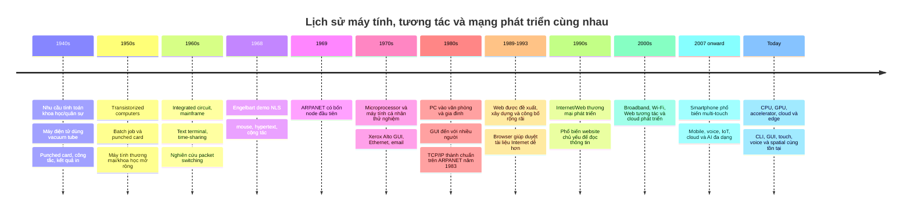
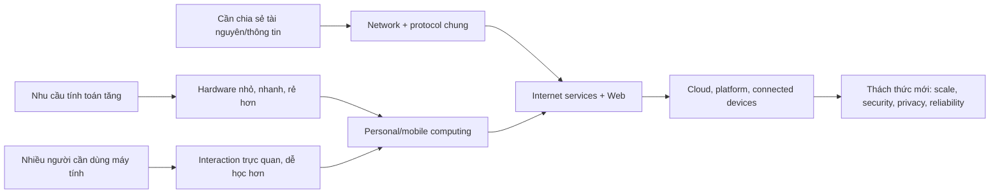

# 00 — History of Computing, HCI & the Internet

> **Ý chính:** nhu cầu tính toán, chia sẻ tài nguyên/thông tin và giúp nhiều người sử dụng máy tính đã cùng thúc đẩy ba mạch phát triển: **phần cứng**, **tương tác người–máy**, và **mạng Internet/Web**.

Chương này đi theo **trình tự thời gian**, nhưng mỗi mốc sẽ nhìn cả ba mạch để thấy chúng tác động lẫn nhau. Các mốc “thế hệ máy tính” là cách phân kỳ trong sách giáo khoa; năm bắt đầu/kết thúc có thể khác nhau và công nghệ cũ/mới thường cùng tồn tại.

## Timeline tổng quan

### Sơ đồ ghi nhớ: vấn đề → thay đổi → hệ quả

## Trước và trong thập niên 1940 — Calculation chuyển sang điện tử

Trước máy tính điện tử, con người dùng **mechanical calculator**, biểu mẫu giấy, **punched card** (thẻ đục lỗ) và cả những nhân viên làm phép tính thủ công. Bài toán khoa học, chính phủ và quân sự đòi hỏi lặp lại rất nhiều phép tính, vượt quá tốc độ con người.

**ENIAC (Electronic Numerical Integrator and Computer)** được xây dựng cho phòng thí nghiệm đạn đạo của quân đội Mỹ để tính bảng bắn pháo. Máy dùng **vacuum tube** (đèn điện tử chân không), được giới thiệu năm 1946. Đây là máy điện tử số quy mô lớn, có thể lập trình, nhưng thiết kế ban đầu **chưa phải stored-program computer** theo nghĩa hiện đại. Cẩn thận với câu “ENIAC là máy tính đầu tiên” vì câu trả lời phụ thuộc định nghĩa máy tính nào.

*Ảnh và lịch sử: [Computer History Museum — ENIAC](https://www.computerhistory.org/tdih/may/17/). Dự án bắt đầu năm 1943, ENIAC được giới thiệu tháng 2/1946.*

**User interaction:** người vận hành cài dây/công tắc, dùng băng giấy hoặc punched card để nhập dữ liệu, rồi chờ kết quả in/ghi ra. Đây là **batch processing**: chuẩn bị việc → nộp cho máy → đợi kết quả; chưa có phản hồi tức thì như app ngày nay.

## 1947–1959 — Transistor giải bài toán kích thước và độ bền

Các nhà nghiên cứu Bell Labs trình diễn **point-contact transistor** năm 1947. Transistor có thể khuếch đại/chuyển mạch điện tử mà không cần bóng đèn lớn, nóng và tiêu thụ nhiều điện như vacuum tube. Nhưng transistor thời đầu chưa tự nhiên rẻ hay dễ sản xuất; vật liệu và quy trình chế tạo cũng phải tiến bộ.

**Vì sao quan trọng?** Độ bền cao hơn, kích thước và điện năng thấp hơn giúp máy tính nhỏ dần và dễ triển khai hơn. Hai công nghệ không đổi chỗ ngay lập tức; quá trình chuyển đổi diễn ra qua nhiều năm.

## 1950s–1960s — Mainframe, batch processing và time-sharing

**Mainframe** phục vụ tác vụ khoa học, kinh doanh và chính phủ. Nhiều công việc ban đầu vẫn chạy theo lô (**batch job**). Khi nhiều người cùng cần dùng một máy trung tâm đắt tiền, **time-sharing** chia thời gian xử lý thành lát nhỏ để người dùng thao tác qua các **terminal**.

Terminal thường là màn hình chữ + bàn phím; người dùng nhập lệnh và nhận kết quả dạng text. Nó có tính tương tác nhưng chưa phải giao diện đồ họa point-and-click. Đây là liên hệ quan trọng giữa hạ tầng và UI: phần cứng dùng chung dẫn đến nhu cầu về scheduling và truy cập từ xa.

## 1947–1971 — Semiconductor tiến đến microprocessor

| Mốc | Điều gì thay đổi? | Vì sao đáng nhớ? |
|---|---|---|
| 1947: transistor được trình diễn | Linh kiện bán dẫn dùng để chuyển mạch/khuếch đại | Nhỏ và tiết kiệm điện hơn vacuum tube. |
| 1958–1959: các hướng phát triển integrated circuit | Nhiều linh kiện được tạo/kết nối trên nền bán dẫn | Giảm lắp ráp rời rạc; Jack Kilby và Robert Noyce có những đóng góp riêng, quan trọng cho IC. |
| 1960s: MOS và planar manufacturing tiến bộ | Thiết bị bán dẫn dày đặc, chế tạo ổn định hơn | Làm tăng khả năng tích hợp và sản xuất số lượng lớn. |
| 1971: Intel 4004 ra mắt | Chức năng CPU được tích hợp trên một microprocessor thương mại | Giúp hệ thống lập trình được trở nên nhỏ và phổ biến hơn. |

Mẫu hình lịch sử là **integration**: giảm số linh kiện phải nối riêng, tăng mật độ và cải thiện sản xuất để giảm chi phí cho mỗi phép tính. Không có một phát minh đơn lẻ nào ngay lập tức tạo ra máy tính hiện đại.

🖼️ Xem [The Silicon Engine timeline — Computer History Museum](https://www.computerhistory.org/siliconengine/timeline/): timeline và hình ảnh về transistor, IC, MOS, microprocessor.

## 1960s–1970s — Tương tác chuyển từ “nộp việc” sang đối thoại và trỏ chuột

### CLI và text terminal

**CLI (Command-Line Interface)** là cách nhập lệnh dạng chữ. CLI vẫn rất hữu ích cho automation, remote administration và các tác vụ lặp lại; GUI xuất hiện không làm CLI biến mất. Trước cả terminal tương tác, người dùng đã có punched card và paper tape, nên không có một năm duy nhất mà “CLI bắt đầu”.

### Engelbart demo năm 1968

Năm 1968, nhóm Douglas Engelbart tại SRI trình diễn **NLS (oN-Line System)**. NLS có mouse, hypertext links, cộng tác chỉnh sửa và videoconferencing. Điểm đáng nhớ không chỉ là con chuột: máy tính được trình bày như công cụ giúp con người cộng tác và kết nối ý tưởng.

🖼️ [The Mother of All Demos — Computer History Museum](https://www.computerhistory.org/timeline/1968/) có tư liệu lịch sử về buổi demo NLS.

### Xerox Alto, 1973 — GUI trong môi trường nghiên cứu

Xerox Alto kết hợp bitmap display, mouse, windows, icons, networking và soạn thảo WYSIWYG trong một hệ thống nghiên cứu personal computing. Alto có ảnh hưởng lớn nhưng **không phải sản phẩm bán đại trà**. Xerox Star (1981), Apple Lisa (1983), Macintosh (1984) và các hệ thống sau đó đưa các ý tưởng GUI đến người dùng thương mại theo những cách khác nhau.

**GUI (Graphical User Interface)** cho người dùng thấy đối tượng và hành động trực quan, giảm việc phải nhớ cú pháp lệnh cho thao tác thông thường. Đổi lại, thiết kế GUI cần quan tâm khả năng khám phá, accessibility, diện tích màn hình, tính nhất quán và độ chính xác khi nhập.

*Ảnh và các ví dụ GUI: [Xerox Alto — Computer History Museum](https://www.computerhistory.org/revolution/story/347).*

## 1960s–1980s — Từ packet switching đến Internet

### Vì sao có ARPANET?

ARPA tài trợ nghiên cứu để kết nối máy tính và chia sẻ tài nguyên xử lý giữa các cơ sở nghiên cứu. Một bài toán kỹ thuật là làm sao nhiều máy khác nhau, dùng mạng khác nhau, có thể trao đổi dữ liệu. **Packet switching** chia dữ liệu thành packet để chuyển tiếp qua mạng; cách này giúp chia sẻ đường truyền linh hoạt và cho phép tìm đường qua các node khả dụng.

⚠️ **Đính chính giai thoại phổ biến:** “ARPANET được tạo ra để quân đội Mỹ liên lạc sau một cuộc tấn công hạt nhân” là cách kể đơn giản hóa, không phải lời giải thích đầy đủ cho nguồn gốc ARPANET. Các động lực ban đầu gồm chia sẻ tài nguyên và kết nối máy tính nghiên cứu. Tính chịu lỗi là lợi ích của mạng packet phân tán và thuộc bối cảnh nghiên cứu rộng hơn; đừng học thuộc chuyện chiến tranh hạt nhân như nguồn gốc đã được chứng minh duy nhất.

Năm 1969, bốn node đầu kết nối UCLA, Stanford Research Institute (SRI), UC Santa Barbara và University of Utah. Ngày 29/10, thông điệp host-to-host đầu tiên được gửi thử là “LO”: hệ thống lỗi trước khi hoàn tất từ “LOGIN”. Email xuất hiện không lâu sau đó và trở thành một ứng dụng mạng quan trọng ban đầu.

*Ảnh, bản đồ bốn node và sơ đồ packet network: [DARPA — ARPANET history](https://www.darpa.mil/news/features/arpanet).*

### TCP/IP giúp các mạng “nói chuyện” với nhau

Sau khi nối được một số máy, thách thức tiếp theo là kết nối **nhiều mạng khác công nghệ**. **TCP/IP (Transmission Control Protocol / Internet Protocol)** là bộ giao thức chung cho việc **internetworking**. Ngày 1/1/1983, ARPANET chuyển sang TCP/IP; đây là cột mốc quan trọng trong quá trình hình thành Internet. Internet là **network of networks**, không phải một sợi cáp hay một website duy nhất.

## 1970s–1990s — Personal computer, LAN và Web

Microprocessor giúp những máy nhỏ hơn trở nên khả thi về chi phí. **PC (Personal Computer)** đưa máy tính đến bàn làm việc, trường học và gia đình. **Ethernet** và **LAN (Local Area Network)** kết nối máy trong phạm vi gần; email, chia sẻ file và máy in đã hữu ích trước khi Web xuất hiện.

### Internet khác World Wide Web

- **Internet:** hạ tầng mạng liên kết toàn cầu và hệ giao thức giúp các mạng trao đổi dữ liệu.
- **World Wide Web (WWW / Web):** một hệ thống thông tin chạy trên Internet, dùng tài nguyên liên kết và các công nghệ như URL, HTTP, HTML, server và browser.
- Email, file transfer, remote login và DNS là dịch vụ Internet nhưng **không phải Web**.

Tháng 3/1989, Tim Berners-Lee đề xuất tại CERN một hệ thống quản lý thông tin để nhà nghiên cứu chia sẻ tài liệu qua nhiều máy tính/tổ chức. Đến năm 1990, các thành phần Web và browser/server đầu tiên được triển khai; website đầu tiên chạy tại CERN. Tháng 4/1993, CERN công bố phần mềm Web để cộng đồng sử dụng, góp phần thúc đẩy Web lan rộng.

*Ảnh và lịch sử: [The birth of the Web — CERN](https://home.cern/science/computing/the-birth-of-the-web). Có thể xem [website đầu tiên đã phục dựng](https://info.cern.ch/).*

**Ý nghĩa:** trước Web, người dùng thường phải biết công cụ và địa chỉ riêng cho từng dịch vụ. Hyperlink và browser giúp điều hướng tài liệu giữa các hệ thống dễ hơn. Web không tạo ra Internet; nó làm một ứng dụng quan trọng trên Internet dễ tiếp cận hơn.

## 1990s–2000s — Web trở nên tương tác

Web phát triển từ những trang chủ yếu do nhà xuất bản viết thành dịch vụ có server/database, search, thương mại điện tử, forum, blog, mạng xã hội và nội dung do người dùng tạo. **Web 1.0 / Web 2.0** là cách gọi phổ biến để ghi nhớ thay đổi trong cách dùng Web, **không phải phiên bản giao thức chính thức**.

Broadband và Wi-Fi giúp truy cập hàng ngày tốt hơn; laptop rồi điện thoại giúp người dùng kết nối di động. **Server virtualization** và hosted platform giúp tổ chức phân bổ tài nguyên linh hoạt hơn. **Cloud computing** phát triển theo hướng cung cấp compute, storage và managed service qua mạng theo nhu cầu.

## Từ 2007 đến nay — Touch, mobile, cloud và giao diện mới

Touchscreen đã có trước smartphone. iPhone ra mắt năm 2007 là cột mốc **phổ biến multi-touch trên smartphone**, không phải phát minh ra tương tác cảm ứng. Smartphone kết hợp máy tính nhỏ gọn, sensor, wireless networking và giao diện điều khiển bằng ngón tay.

Voice assistant, conversational UI và generative AI giúp tương tác bằng ngôn ngữ tự nhiên phổ biến hơn. **AR (Augmented Reality)** và **VR (Virtual Reality)** mở ra spatial interface. Các kiểu này bổ sung cho bàn phím, CLI và GUI chứ không xóa bỏ chúng. Mỗi kiểu lại đặt yêu cầu hạ tầng về identity, network, compute, latency, privacy, accessibility và security.

Hạ tầng ngày nay kết hợp CPU, GPU/accelerator; thiết bị cá nhân, data center, cloud và edge; virtualization, container; mạng có dây/không dây; cùng security và observability xuyên suốt.

## 5 điều cần nhớ cho IE101

1. **Hardware tiến hóa để giải các giới hạn:** vacuum tube → transistor → IC → microprocessor; độ bền, mật độ, điện năng và chi phí cải thiện dần theo thời gian.
2. **Interaction thay đổi theo người dùng và workload:** punched card/batch → text terminal/CLI → mouse/GUI → touch/mobile → voice/spatial. Các cách cũ vẫn được dùng.
3. **Internet ≠ Web:** Web là hệ thống thông tin chạy trên Internet.
4. **ARPANET thường bị kể sai nguồn gốc:** nhớ resource sharing, research networking, packet switching, interoperability; đừng giản lược thành chuyện sống sót sau tấn công hạt nhân.
5. Với mỗi mốc, ghi nhớ **problem → invention → trade-off / next problem**. Ví dụ: các mạng không tương thích → TCP/IP kết nối mạng → nhu cầu tìm/chia sẻ thông tin dễ dàng hơn → Web.

## Bảng ôn nhanh: vấn đề → thay đổi → hệ quả

| Áp lực lịch sử | Thay đổi | Hệ quả / thách thức mới |
|---|---|---|
| Tính toán thủ công quá chậm | Electronic computing | Nhanh hơn nhưng máy cồng kềnh, đắt, cần chuyên gia vận hành. |
| Vacuum tube lớn, nóng, dễ hỏng | Transistor và semiconductor manufacturing | Máy nhỏ hơn; nhu cầu tích hợp linh kiện tiếp tục tăng. |
| Nhiều linh kiện rời tốn chi phí lắp ráp | IC và microprocessor | PC và thiết bị nhúng trở nên khả thi ở quy mô lớn. |
| Batch chậm, khó tiếp cận | Terminal, mouse, GUI | Tương tác trực tiếp hơn; nảy sinh bài toán usability/accessibility. |
| Máy và mạng nghiên cứu rời rạc | ARPANET, packet switching, TCP/IP | Các mạng liên kết được; phát sinh yêu cầu routing/security/governance. |
| Khó tìm thông tin trên Internet | Web links, URL, HTTP, HTML, browser | Người dùng dễ truy cập hơn; phát sinh thách thức privacy, scale, reliability. |
| Cần truy cập ở mọi nơi và tương tác tự nhiên | Mobile, broadband, cloud, voice | Luôn kết nối; cần quản lý identity, latency, dữ liệu và privacy. |

## Nguồn tư liệu và hình ảnh

- [ENIAC — Computer History Museum](https://www.computerhistory.org/tdih/may/17/) — mục đích dự án và thời điểm ra mắt; có ảnh lịch sử.
- [The Silicon Engine timeline — Computer History Museum](https://www.computerhistory.org/siliconengine/timeline/) — transistor, IC, MOS, microprocessor và hình minh họa.
- [The Mouse — Computer History Museum](https://www.computerhistory.org/revolution/story/350) — mouse của Engelbart và bối cảnh lịch sử.
- [The Mother of All Demos — Computer History Museum](https://www.computerhistory.org/timeline/1968/) — NLS, mouse, hypertext và cộng tác.
- [Xerox Alto — Computer History Museum](https://www.computerhistory.org/revolution/story/347) — GUI, WYSIWYG, networking và hiện vật.
- [ARPANET — DARPA](https://www.darpa.mil/news/features/arpanet) — node đầu tiên, packet switching, mốc TCP/IP và bản đồ.
- [The birth of the Web — CERN](https://home.cern/science/computing/the-birth-of-the-web) — lý do CERN cần Web, các mốc, ảnh và trang đầu tiên.
- [World Wide Web at 35 — CERN](https://home.cern/world-wide-web-35/) — proposal đầu tiên, quá trình triển khai và thời điểm phát hành.

**Lưu ý về độ chính xác:** “thế hệ máy tính” và “Web 1.0/2.0” là cách tóm tắt để học, không phải ranh giới lịch sử tuyệt đối. Ghi nhớ mốc có nguồn và vấn đề mà mốc đó giải quyết.
