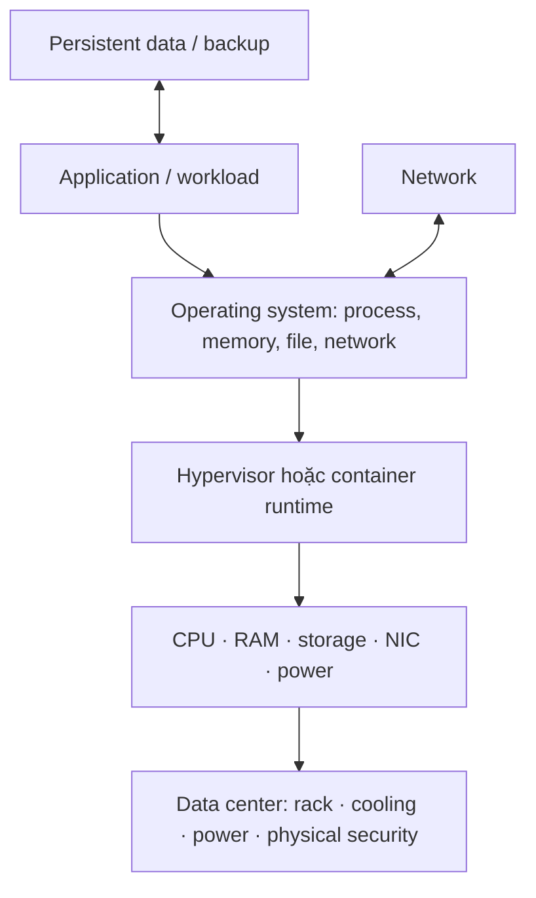
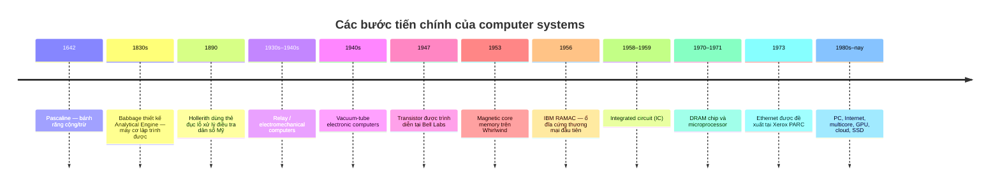
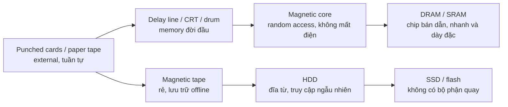
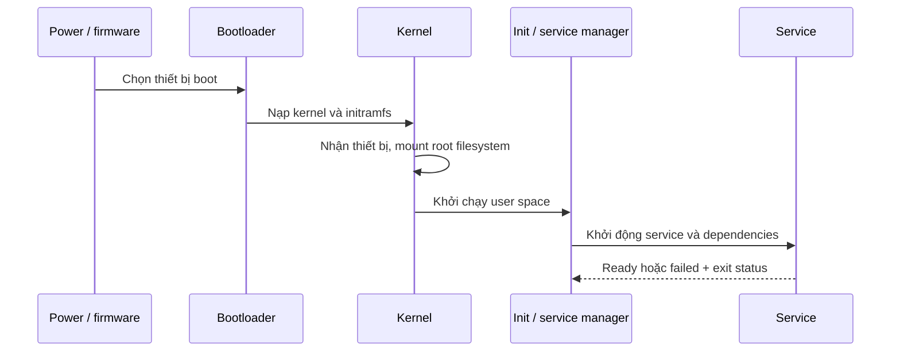

# 01 — Computer Systems: Hardware, OS & Performance

> ⭐ **Ý chính:** hạ tầng là một stack tài nguyên có giới hạn. Hệ thống chậm khi một tài nguyên hoặc dependency không đáp ứng được workload.

## 1. Stack hạ tầng

**IT infrastructure** gồm compute, network, storage, facilities, software platform, identity, monitoring, backup và quy trình/con người vận hành. Stack này giúp tư duy; ngoài thực tế các lớp có thể được gộp hoặc dùng managed service.

## 2. Vì sao các linh kiện xuất hiện? — evolution của computer systems

Máy tính hiện đại không xuất hiện một lần. Mỗi thế hệ giải một nút thắt của thế hệ trước: **tính tay quá chậm → tự động hóa phép tính → chuyển mạch nhanh hơn → lưu dữ liệu nhanh hơn → thu nhỏ và kết nối nhiều máy**. Các thế hệ thường cùng tồn tại nhiều năm; đây là những mốc tiêu biểu, không phải một chuỗi thay thế tức thì.

### Từ phép tính cơ học đến electronic computer

| Giai đoạn | Trước đó dùng gì? | Vấn đề cần giải | Thay đổi và ý nghĩa |
|---|---|---|---|
| **Bàn tính / máy cơ (trước thế kỷ 20)** | Người tính bằng tay, bàn tính; sau đó là máy bánh răng như Pascaline (Blaise Pascal, 1642). | Tính lặp nhiều bước dễ chậm và sai; bánh răng giúp tự động hóa một số phép toán nhưng máy vẫn chuyên dụng, khó lập trình. | Charles Babbage thiết kế **Analytical Engine** từ thập niên 1830 với ý tưởng về bộ xử lý, bộ nhớ và chương trình; máy không được hoàn thành đúng thiết kế vì giới hạn chế tạo và kinh phí. Ada Lovelace mô tả cách lập chuỗi thao tác cho máy. Đây là tiền thân về ý tưởng, chưa phải máy điện tử hiện đại. |
| **Thẻ đục lỗ (1890 trở đi)** | Biểu mẫu giấy được con người đọc và tổng hợp thủ công. | Dân số Mỹ tăng mạnh khiến Cục Điều tra Dân số lo việc thống kê thủ công kỳ 1890 sẽ chưa xong trước kỳ 1900. | Herman Hollerith dùng thẻ đục lỗ và máy tabulating điện cơ cho điều tra dân số 1890. Thẻ vừa mã hóa dữ liệu vừa làm đầu vào; sau này dùng để nhập dữ liệu/chương trình, nhưng phải đục thẻ, xếp tuần tự và khó sửa. [CHM: Hollerith](https://www.computerhistory.org/revolution/story/2) |
| **Relay / electromechanical (1930s–1940s)** | Máy cơ bánh răng, người vận hành, bảng dây cắm; thẻ/film tape cung cấp chương trình và dữ liệu. | Cơ cấu cơ học bị giới hạn bởi chuyển động vật lý; cần tự động hóa logic nhị phân và điều khiển chuỗi phép tính. | **Relay** là công tắc điện cơ đóng/mở bằng nam châm điện. Konrad Zuse dùng relay trong Z2/Z3 ở Đức; Z3 chạy năm 1941. Relay dễ hiểu và dùng linh kiện sẵn có (kể cả relay điện thoại), nhưng tiếp điểm di chuyển nên chậm, ồn, mòn. |
| **Vacuum tube / thermionic valve (1900s; computer 1940s)** | Relay và linh kiện cơ khí; ống chân không ban đầu được phát triển cho chỉnh lưu, khuếch đại và radio, chưa phải “phát minh ra để làm PC”. | Relay chậm vì có bộ phận cơ học. Radio/điện thoại cũng cần khuếch đại tín hiệu yếu và chuyển mạch nhanh hơn. | John Ambrose Fleming làm diode ống chân không năm 1904; Lee de Forest thêm lưới điều khiển, tạo triode năm 1906. Ống chân không khuếch đại/chuyển mạch bằng dòng electron trong chân không, không có tiếp điểm chuyển động. Máy điện tử như Colossus (mục đích chuyên biệt: giải mã) và ENIAC dùng hàng nghìn ống để tính nhanh hơn relay; đổi lại tiêu thụ điện, tỏa nhiệt, cồng kềnh và cần bảo trì. [CHM: vacuum tubes and computers](https://www.computerhistory.org/revolution/digital-logic/12/271) |
| **Transistor (1947 →)** | Vacuum tube vẫn làm khuếch đại và logic trong máy tính. | Ống lớn, nóng, tốn điện, dễ hỏng; cần phần tử bán dẫn nhỏ và đáng tin cậy hơn. | John Bardeen và Walter Brattain tạo transistor tiếp điểm tại Bell Labs năm 1947; William Shockley phát triển lý thuyết transistor tiếp giáp. Transistor làm công việc đóng/mở hoặc khuếch đại bằng bán dẫn, nhỏ và tiết kiệm điện hơn. Máy tính transistor xuất hiện đầu thập niên 1950, nhưng ban đầu transistor đắt và cần quy trình vật liệu tinh khiết. [CHM: transistor → microprocessor](https://www.computerhistory.org/revolution/story/272) |
| **Integrated circuit (IC, cuối 1950s →)** | Một bo mạch ghép nhiều transistor, diode, điện trở riêng bằng dây và mối hàn. | Số linh kiện tăng thì bo lớn, nhiều mối nối, tốn công lắp ráp và xác suất lỗi tăng. | Jack Kilby (TI) trình diễn solid circuit năm 1958; Robert Noyce (Fairchild) phát triển cấu trúc IC monolithic có kết nối kim loại trên chip silicon năm 1959, giúp sản xuất hàng loạt tốt hơn. Nhiều linh kiện được chế tạo/kết nối trên cùng miếng bán dẫn; đây là nền tảng thu nhỏ CPU và bộ nhớ. [CHM: Noyce’s practical IC](https://www.computerhistory.org/siliconengine/practical-monolithic-integrated-circuit-concept-patented/) |
| **Microprocessor (1971 →)** | CPU được ghép từ nhiều IC logic trên nhiều bo mạch; máy tính thường là hệ thống lớn, đắt và đặt tại tổ chức. | Cần giảm kích thước/giá thành để làm bộ điều khiển và máy tính nhỏ; thiết kế CPU rời quá phức tạp. | Intel 4004 (1971) đưa chức năng CPU lên một chip. **CPU không phải toàn bộ máy tính**: hệ thống vẫn cần RAM, storage, I/O và software. Việc sản xuất hàng loạt IC đưa máy tính tới PC, thiết bị nhúng, rồi điện thoại. [CHM: microprocessor history](https://computerhistory.org/blog/who-invented-the-microprocessor/) |

### Memory và storage: máy tính giữ dữ liệu ở đâu?

Phải tách hai nhu cầu: **memory** giữ dữ liệu đang tính để truy cập nhanh; **storage** giữ dữ liệu lâu dài kể cả khi tắt nguồn. “Trước RAM” cũng không chỉ có một công nghệ: máy đời đầu thử nhiều cách khác nhau.

| Công nghệ / mốc | Trước đó hoặc giới hạn | Vì sao chuyển sang bước mới? |
|---|---|---|
| **Punched cards / paper tape** | Lưu được chương trình hoặc dữ liệu bên ngoài máy; phải đọc tuần tự, thao tác vật lý, dung lượng thấp. | Phù hợp nhập/xuất, nhưng CPU cần vùng nhớ trong nhanh hơn. Các dạng này vẫn tồn tại sau khi RAM ra đời cho nhập liệu, lưu trữ offline và thiết bị chuyên dụng. |
| **Delay line, Williams tube, magnetic drum (1940s–1950s)** | Máy lưu bit bằng xung âm chạy trong ống thủy ngân, điện tích trên CRT hoặc từ tính trên trống quay. Một số loại tuần tự/khó truy cập đúng địa chỉ; CRT dễ mất ổn định. | Những máy lưu chương trình cần truy xuất nhanh, tin cậy hơn. Không có một “RAM đầu tiên duy nhất”: từng máy chọn giải pháp khác nhau. [CHM: early memory approaches](https://www.computerhistory.org/brochures/memory/) |
| **Magnetic core memory (1953–1970s)** | Thay các bộ nhớ đời đầu thiếu tin cậy/chậm bằng lưới vòng ferrite; mỗi vòng giữ một bit từ tính, giữ được dữ liệu không cần điện. | Jay Forrester hoàn thiện cách chọn lõi bằng dòng điện trùng hợp cho MIT Whirlwind; máy dùng core năm 1953. Core nhanh, random access, bền và không volatile, nhưng đắt, cồng kềnh và phải luồn dây qua từng vòng rất công phu. [CHM: Whirlwind core memory](https://www.computerhistory.org/storageengine/whirlwind-computer-debuts-core-memory/) |
| **Semiconductor RAM / DRAM (1970s →)** | Core memory cần lắp ráp thủ công và khó tăng mật độ. | DRAM lưu bit bằng điện tích trong cell transistor-capacitor, cần refresh định kỳ nhưng có thể chế tạo dày đặc và rẻ hơn. Intel 1103 (1970) là cột mốc DRAM thương mại 1 Kbit tạo sức ép lớn lên core. RAM hiện đại nhanh, nhưng DRAM thường volatile: mất điện thì mất nội dung. [CHM: semiconductor timeline](https://www.computerhistory.org/siliconengine/timeline/) |
| **Tape → HDD → SSD/flash** | Tape rẻ và mang đi được nhưng phải tua đến vị trí; card/tape quá bất tiện cho tra cứu thường xuyên. | IBM RAMAC 305 giao năm 1956 với ổ đĩa từ đầu tiên mang tính thương mại, cho truy cập ngẫu nhiên trực tiếp tới lượng dữ liệu lớn hơn. HDD tiếp tục tăng dung lượng; SSD dùng flash không có bộ phận quay nên giảm độ trễ cơ học và chống rung tốt hơn, thường đổi lại giá mỗi GB cao hơn. [CHM: storage timeline](https://www.computerhistory.org/timeline/memory-storage/) |

### Từ máy độc lập đến network, virtualization và cloud

- **Trước NIC/network hiện đại:** máy thường hoạt động độc lập; người dùng nạp thẻ/tape hoặc kết nối console/terminal trực tiếp. Muốn trao đổi dữ liệu giữa địa điểm phải mang media, dùng đường truyền nối tiếp/modem hoặc hệ thống chuyên dụng.
- **NIC (Network Interface Card):** phần cứng đưa frame/packet giữa host và link mạng. Khi máy tính cần chia sẻ tài nguyên và trao đổi dữ liệu, cần giao diện mạng chuẩn hóa. Ethernet được Bob Metcalfe đề xuất tại Xerox PARC năm 1973 để nối các máy trong LAN; NIC chỉ nối host vào link, còn switch chuyển frame trong LAN, router chuyển packet giữa các mạng. [CHM: Ethernet](https://www.computerhistory.org/tdih/may/22/)
- **Virtualization:** thay vì một máy vật lý chỉ chạy một môi trường, hypervisor chia phần cứng thành nhiều virtual machine có OS riêng. Ý tưởng này hữu ích trên mainframe từ lâu; x86 virtualization phổ biến rộng hơn về sau. Mục tiêu là gom tải, cô lập và cấp tài nguyên linh hoạt, nhưng vẫn phải quản lý host, storage và network bên dưới.
- **Containers:** đóng gói ứng dụng và dependencies, cô lập process bằng kernel của host; nhẹ hơn VM nhưng không phải một OS kernel riêng cho mỗi container. Ra đời từ các cơ chế cô lập OS (chroot, jails, namespaces/cgroups), phục vụ triển khai ứng dụng lặp lại và nhanh.
- **Cloud:** cung cấp compute, storage, network qua API/portal và tính phí theo mức dùng. Đây là mô hình cung cấp/vận hành hạ tầng, không phải một linh kiện mới: cloud vẫn chạy trên server, network, storage và data center; người dùng đổi quyền tự quản lấy tốc độ cấp phát và khả năng co giãn.

### Nhớ nhanh: “cũ làm gì, mới giải quyết gì?”

| Nút thắt | Công nghệ trước | Bước tiến | Đánh đổi còn lại |
|---|---|---|---|
| Tính thủ công chậm | Người + bàn tính | Máy cơ, rồi relay | Cơ khí/relay có giới hạn tốc độ và độ bền |
| Relay chậm, nhiều bộ phận chuyển động | Relay | Vacuum tube, rồi transistor | Tube nóng/tốn điện; transistor đòi quy trình bán dẫn tốt |
| Mạch rời quá lớn, nhiều mối nối | Transistor rời | IC → microprocessor | Sản xuất chip cực kỳ phức tạp; lỗi thiết kế ảnh hưởng hàng triệu chip |
| Bộ nhớ đời đầu khó truy cập/không ổn định | Delay line / CRT / drum | Core → DRAM/SRAM | DRAM cần refresh; RAM hiện đại thường mất dữ liệu khi mất điện |
| Lưu trữ tuần tự, tìm dữ liệu lâu | Thẻ/tape | HDD → SSD | HDD cơ học; SSD có giới hạn ghi và giá/dung lượng tùy loại |
| Máy không chia sẻ dữ liệu | Media mang tay / terminal | NIC + Ethernet + Internet | Kết nối tạo thêm rủi ro bảo mật và phụ thuộc mạng |

⭐ **Cách nhìn hệ thống:** một innovation hiếm khi “làm máy tính hoàn chỉnh”. Transistor không thay RAM; IC không thay network; cloud không xóa phần cứng. Mỗi bước cải thiện một lớp, rồi làm xuất hiện nhu cầu mới ở lớp kế tiếp (ví dụ CPU nhanh hơn khiến memory/I/O thành bottleneck).

## 3. Hardware: từng tài nguyên làm gì?

| Thành phần | Hình dung | Chỉ số nên xem | Dấu hiệu nghẽn thường gặp |
|---|---|---|---|
| **CPU (Central Processing Unit)** | Thực thi instruction; nhiều core chạy song song nếu workload cho phép. | Utilization, run queue, per-core usage, throttling. | Tính toán chậm; một core đầy vẫn có thể nghẽn dù CPU tổng thể thấp. |
| **RAM (Random Access Memory)** | Vùng làm việc nhanh, volatile cho code và dữ liệu đang dùng. | Working set, available memory, page fault, swap/pagefile. | Paging liên tục làm latency tăng; chỉ thêm RAM nếu có bằng chứng memory pressure. |
| **Storage** | Lưu dữ liệu bền vững. | Latency, IOPS, throughput, queue depth, capacity, error. | Database chờ I/O, filesystem đầy, boot chậm hoặc write lỗi. |
| **NIC (Network Interface Card)** | Điểm giao tiếp của host với mạng. | Link speed, drop/error, utilization, retransmission. | Packet loss, link thương lượng tốc độ thấp, uplink quá tải. |
| **GPU (Graphics Processing Unit)** | Accelerator song song cho workload phù hợp. | Utilization, device memory, temperature, power. | Workload quay lại CPU hoặc hết bộ nhớ GPU. |
| **PSU / UPS** | Power Supply Unit / Uninterruptible Power Supply. | Trạng thái nguồn dự phòng, battery health, runtime. | Tắt đột ngột hoặc dữ liệu ghi dở khi mất điện. |

⭐ **Đơn vị:** 1 byte = 8 bit. `GB` thập phân = 10⁹ byte; `GiB` nhị phân = 2³⁰ byte. Link 100 Mbps có trần lý thuyết 12.5 MB/s trước overhead. Luôn xem đang nói bit hay byte, GB hay GiB.

## 4. Performance, capacity và bottleneck

- **Latency** = thời gian hoàn tất một thao tác/request; thấp thường tốt. Nên xem percentile như p95 thay vì chỉ average.
- **Throughput** = lượng việc hoàn tất mỗi đơn vị thời gian (request/s, MB/s).
- **IOPS (Input/Output Operations Per Second)** = số thao tác storage mỗi giây; cần xem kèm kích cỡ mỗi thao tác.
- **Concurrency** = số việc đang xử lý đồng thời; khác với tổng số user đăng ký.
- **Utilization** = phần trăm tài nguyên đang dùng. Phải xem cùng latency, queue và error để biết có bão hòa hay không.
- **Queue depth** = số việc chờ tài nguyên. Queue và latency cùng tăng thường là dấu hiệu nghẽn.

⚠️ Không kết luận từ một chỉ số. CPU trung bình thấp vẫn có thể có single-thread bottleneck, disk wait, lock contention, DNS delay hoặc dependency chậm.

**Little’s Law**: ở trạng thái ổn định, `concurrency ≈ throughput × average latency` (đổi đơn vị thời gian cho khớp). 200 request/s × 0.25 s ≈ 50 request đang chạy. Đây là ước lượng, không phải cam kết capacity.

### Scaling

- **Scale up / vertical scaling:** tăng CPU/RAM/I/O của một host. Dễ vận hành nhưng có giới hạn phần cứng và đôi khi cần downtime.
- **Scale out / horizontal scaling:** thêm instance rồi phân tải. Thường cần load balancer, health check và xử lý state (stateless app hoặc shared/partitioned state).
- **Capacity headroom:** phần dư cho peak, bảo trì, sự cố và tăng trưởng. Ghi lại giả định thay vì chọn con số dự phòng tùy ý.

## 5. OS (Operating System)

OS quản lý CPU scheduling, virtual memory, filesystem, thiết bị, network, identity và isolation. App dùng **system call** để yêu cầu kernel thực hiện thao tác đặc quyền.

| Thuật ngữ | Nghĩa ngắn |
|---|---|
| **Kernel** | Phần đặc quyền quản lý hardware và abstraction của OS. |
| **Process** | Chương trình đang chạy, có virtual address space và tài nguyên riêng. |
| **Thread** | Luồng thực thi bên trong process; các thread thường chia sẻ memory của process. |
| **Service / daemon** | Process nền cung cấp chức năng; service manager quản lý start/stop/health. |
| **File descriptor / handle** | Tham chiếu OS tới file, socket, pipe hoặc resource đang mở. |
| **Filesystem** | Cách đặt tên, lưu trữ và truy xuất file. |
| **Permission / ACL** | Quy tắc identity nào được phép làm action nào. |
| **Patch** | Bản cập nhật có thể sửa security/reliability; cần kiểm tra tương thích và rollback. |

## 6. Thực hành troubleshooting

1. **Định nghĩa impact:** ai bị ảnh hưởng, từ khi nào, có thay đổi gì?
2. **Khoanh vùng layer:** một process, host, subnet, site hay external dependency?
3. **Thu thập evidence trước khi đổi trạng thái:** service status, logs, CPU/RAM/disk, connectivity, lần deploy/config gần nhất.
4. **Mỗi lần kiểm tra một hypothesis:** nói rõ quan sát nào xác nhận hoặc bác bỏ giả thuyết.
5. **Mitigate an toàn:** giữ dữ liệu, ghi lại thay đổi và rollback; đừng reboot mọi thứ như bước đầu tiên.
6. **Xác minh từ góc nhìn user**, rồi ghi nguyên nhân, cách sửa và phòng ngừa.

🧪 Lệnh quan sát read-only: Windows `Get-Process`, `Get-Service`, `Get-Volume`, `ipconfig /all`, `Get-NetIPConfiguration`; Linux `ps aux`, `systemctl status <service>`, `df -h`, `free -h`, `ip address`, `ip route`. Output có thể lộ username, path hoặc secret; đừng đưa nguyên log lên repo công khai.

## Câu hỏi tự nhớ

1. Vì sao CPU tổng thể 20% nhưng vẫn có thể nghẽn CPU?
2. Khi nào xem IOPS, khi nào xem throughput?
3. Dữ liệu nào giúp phân biệt memory pressure với CPU-bound workload?
4. Vì sao “restart server” là bước chẩn đoán đầu tiên chưa tốt?
5. Nêu một trade-off giữa scale up và scale out.

6. Vì sao máy đời đầu thử delay line/CRT/drum trước khi core memory trở thành phổ biến?
7. Transistor và IC khác nhau ở điểm nào?
8. Tape, HDD và SSD khác nhau thế nào về cách truy cập dữ liệu?
9. Cloud là linh kiện, phần mềm hay mô hình cung cấp dịch vụ? Giải thích bằng stack.
