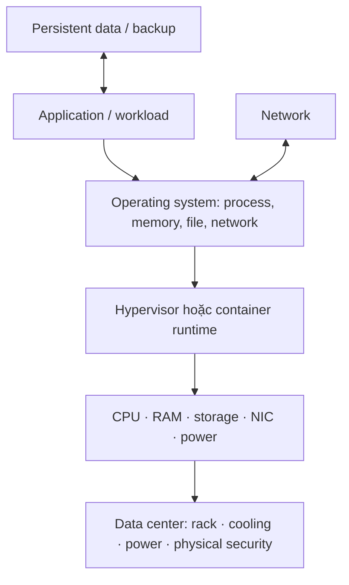
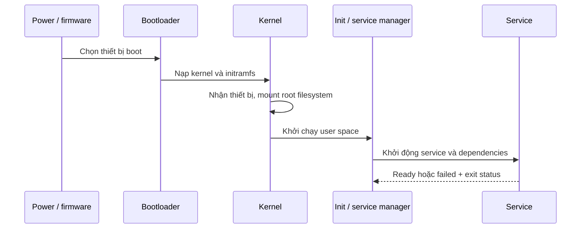

# 01 — Computer Systems: Hardware, OS & Performance

> ⭐ **Ý chính:** hạ tầng là một stack tài nguyên có giới hạn. Hệ thống chậm khi một tài nguyên hoặc dependency không đáp ứng được workload.

## 1. Stack hạ tầng

**IT infrastructure** gồm compute, network, storage, facilities, software platform, identity, monitoring, backup và quy trình/con người vận hành. Stack này giúp tư duy; ngoài thực tế các lớp có thể được gộp hoặc dùng managed service.

## 2. Hardware: từng tài nguyên làm gì?

| Thành phần | Hình dung | Chỉ số nên xem | Dấu hiệu nghẽn thường gặp |
|---|---|---|---|
| **CPU (Central Processing Unit)** | Thực thi instruction; nhiều core chạy song song nếu workload cho phép. | Utilization, run queue, per-core usage, throttling. | Tính toán chậm; một core đầy vẫn có thể nghẽn dù CPU tổng thể thấp. |
| **RAM (Random Access Memory)** | Vùng làm việc nhanh, volatile cho code và dữ liệu đang dùng. | Working set, available memory, page fault, swap/pagefile. | Paging liên tục làm latency tăng; chỉ thêm RAM nếu có bằng chứng memory pressure. |
| **Storage** | Lưu dữ liệu bền vững. | Latency, IOPS, throughput, queue depth, capacity, error. | Database chờ I/O, filesystem đầy, boot chậm hoặc write lỗi. |
| **NIC (Network Interface Card)** | Điểm giao tiếp của host với mạng. | Link speed, drop/error, utilization, retransmission. | Packet loss, link thương lượng tốc độ thấp, uplink quá tải. |
| **GPU (Graphics Processing Unit)** | Accelerator song song cho workload phù hợp. | Utilization, device memory, temperature, power. | Workload quay lại CPU hoặc hết bộ nhớ GPU. |
| **PSU / UPS** | Power Supply Unit / Uninterruptible Power Supply. | Trạng thái nguồn dự phòng, battery health, runtime. | Tắt đột ngột hoặc dữ liệu ghi dở khi mất điện. |

⭐ **Đơn vị:** 1 byte = 8 bit. `GB` thập phân = 10⁹ byte; `GiB` nhị phân = 2³⁰ byte. Link 100 Mbps có trần lý thuyết 12.5 MB/s trước overhead. Luôn xem đang nói bit hay byte, GB hay GiB.

## 3. Performance, capacity và bottleneck

- **Latency** = thời gian hoàn tất một thao tác/request; thấp thường tốt. Nên xem percentile như p95 thay vì chỉ average.
- **Throughput** = lượng việc hoàn tất mỗi đơn vị thời gian (request/s, MB/s).
- **IOPS (Input/Output Operations Per Second)** = số thao tác storage mỗi giây; cần xem kèm kích cỡ mỗi thao tác.
- **Concurrency** = số việc đang xử lý đồng thời; khác với tổng số user đăng ký.
- **Utilization** = phần trăm tài nguyên đang dùng. Phải xem cùng latency, queue và error để biết có bão hòa hay không.
- **Queue depth** = số việc chờ tài nguyên. Queue và latency cùng tăng thường là dấu hiệu nghẽn.

⚠️ Không kết luận từ một chỉ số. CPU trung bình thấp vẫn có thể có single-thread bottleneck, disk wait, lock contention, DNS delay hoặc dependency chậm.

**Little’s Law**: ở trạng thái ổn định, `concurrency ≈ throughput × average latency` (đổi đơn vị thời gian cho khớp). 200 request/s × 0.25 s ≈ 50 request đang chạy. Đây là ước lượng, không phải cam kết capacity.

### Scaling

- **Scale up / vertical scaling:** tăng CPU/RAM/I/O của một host. Dễ vận hành nhưng có giới hạn phần cứng và đôi khi cần downtime.
- **Scale out / horizontal scaling:** thêm instance rồi phân tải. Thường cần load balancer, health check và xử lý state (stateless app hoặc shared/partitioned state).
- **Capacity headroom:** phần dư cho peak, bảo trì, sự cố và tăng trưởng. Ghi lại giả định thay vì chọn con số dự phòng tùy ý.

## 4. OS (Operating System)

OS quản lý CPU scheduling, virtual memory, filesystem, thiết bị, network, identity và isolation. App dùng **system call** để yêu cầu kernel thực hiện thao tác đặc quyền.

| Thuật ngữ | Nghĩa ngắn |
|---|---|
| **Kernel** | Phần đặc quyền quản lý hardware và abstraction của OS. |
| **Process** | Chương trình đang chạy, có virtual address space và tài nguyên riêng. |
| **Thread** | Luồng thực thi bên trong process; các thread thường chia sẻ memory của process. |
| **Service / daemon** | Process nền cung cấp chức năng; service manager quản lý start/stop/health. |
| **File descriptor / handle** | Tham chiếu OS tới file, socket, pipe hoặc resource đang mở. |
| **Filesystem** | Cách đặt tên, lưu trữ và truy xuất file. |
| **Permission / ACL** | Quy tắc identity nào được phép làm action nào. |
| **Patch** | Bản cập nhật có thể sửa security/reliability; cần kiểm tra tương thích và rollback. |

## 5. Thực hành troubleshooting

1. **Định nghĩa impact:** ai bị ảnh hưởng, từ khi nào, có thay đổi gì?
2. **Khoanh vùng layer:** một process, host, subnet, site hay external dependency?
3. **Thu thập evidence trước khi đổi trạng thái:** service status, logs, CPU/RAM/disk, connectivity, lần deploy/config gần nhất.
4. **Mỗi lần kiểm tra một hypothesis:** nói rõ quan sát nào xác nhận hoặc bác bỏ giả thuyết.
5. **Mitigate an toàn:** giữ dữ liệu, ghi lại thay đổi và rollback; đừng reboot mọi thứ như bước đầu tiên.
6. **Xác minh từ góc nhìn user**, rồi ghi nguyên nhân, cách sửa và phòng ngừa.

🧪 Lệnh quan sát read-only: Windows `Get-Process`, `Get-Service`, `Get-Volume`, `ipconfig /all`, `Get-NetIPConfiguration`; Linux `ps aux`, `systemctl status <service>`, `df -h`, `free -h`, `ip address`, `ip route`. Output có thể lộ username, path hoặc secret; đừng đưa nguyên log lên repo công khai.

## Câu hỏi tự nhớ

1. Vì sao CPU tổng thể 20% nhưng vẫn có thể nghẽn CPU?
2. Khi nào xem IOPS, khi nào xem throughput?
3. Dữ liệu nào giúp phân biệt memory pressure với CPU-bound workload?
4. Vì sao “restart server” là bước chẩn đoán đầu tiên chưa tốt?
5. Nêu một trade-off giữa scale up và scale out.
