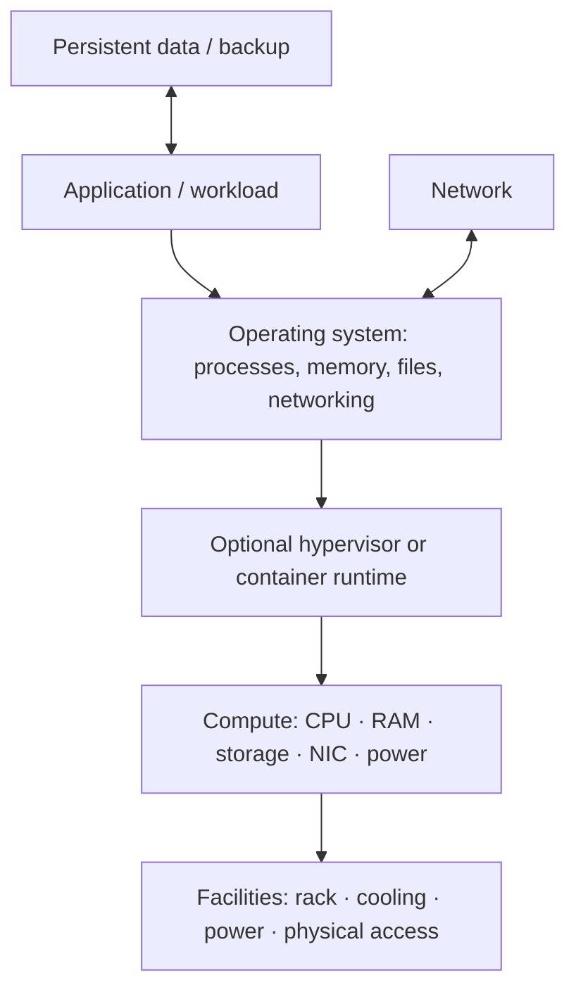
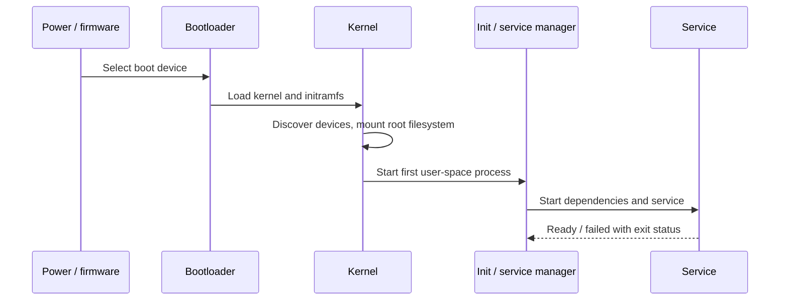

# 01 — Computer Systems: Hardware, OS, and Performance

⭐ **Core idea:** infrastructure is a stack of constrained resources. An application feels slow when one or more resources or dependencies cannot meet its workload.

## 1. Infrastructure as a service stack

**Infrastructure** includes compute, network, storage, facilities, software platforms, identity, monitoring, backup, and the people/processes that operate them. The stack is a reasoning model; real deployments may combine layers or use managed services.

## 2. Hardware: what each resource does

| Resource | Mental model | Useful signals | Typical symptom when constrained |
|---|---|---|---|
| **CPU (Central Processing Unit)** | Executes instructions; cores run work in parallel, subject to dependencies and scheduling. | Utilization, run queue, per-core saturation, throttling. | Slow computation; one hot core can bottleneck an otherwise idle host. |
| **RAM (Random Access Memory)** | Fast, volatile working space for active code and data. | Working set, available memory, page faults, swap/pagefile activity. | Repeated paging can cause severe latency; adding RAM only helps if memory pressure is causal. |
| **Storage** | Persistent block, file, or object data. | Latency, IOPS, throughput, queue depth, capacity, errors. | Database stalls, slow boot, full filesystem, or failed writes. |
| **NIC (Network Interface Card)** | Host’s wired/wireless network endpoint. | Link speed, drops/errors, utilization, retransmissions. | Packet loss, negotiated link downgrade, or saturated uplink. |
| **GPU (Graphics Processing Unit)** | Parallel accelerator for supported workloads. | Utilization, memory, temperature, power. | Accelerator workload falls back to CPU or runs out of device memory. |
| **PSU / UPS** | Power supply / Uninterruptible Power Supply. | Redundant feed status, battery health, runtime estimate. | Unexpected shutdown or unsafe storage writes during power loss. |

⭐ **Units:** 1 byte = 8 bits. Decimal **GB** = 10⁹ bytes; binary **GiB** = 2³⁰ bytes. A 100 Mbps link has a theoretical ceiling of 12.5 MB/s before protocol overhead. Always check whether a vendor means bits or bytes and decimal or binary units.

## 3. Performance, capacity, and bottlenecks

- **Latency**: time for one operation or request. Lower is usually better; report a percentile such as p95, not just an average.
- **Throughput**: completed work per unit time (requests/s, MB/s).
- **IOPS (Input/Output Operations Per Second)**: storage operation rate; operation size matters.
- **Concurrency**: work active at the same time. It is not the same as registered users.
- **Utilization**: fraction of a resource in use. High utilization may be healthy or a saturation warning; interpret with latency, queueing, and errors.
- **Queue depth**: work waiting for a resource. A rising queue with rising latency often signals saturation.

⚠️ **Do not optimize by one metric.** A service can have low average CPU and still be slow because of a single-thread bottleneck, disk wait, lock contention, DNS delay, or a downstream dependency.

**Little’s Law** gives a useful steady-state relationship: `concurrency ≈ throughput × average latency` (units must match). At 200 requests/s and 0.25 s average time, expect roughly 50 in-flight requests. This is a planning estimate, not a safe capacity guarantee.

### Scaling

- **Scale up / vertical scaling**: give one host more CPU, RAM, or I/O capacity. Simple, but bounded by the host and may require downtime.
- **Scale out / horizontal scaling**: add instances and distribute work. Requires health checks, load balancing, and usually stateless app instances or shared/partitioned state.
- **Capacity headroom**: room for peaks, maintenance, failures, and growth. Size from observed workload plus an explicit safety margin; document assumptions.

## 4. OS (Operating System) essentials

The OS manages CPU scheduling, virtual memory, filesystems, devices, networking, identity, and isolation. Applications use **system calls** to request privileged operations from the kernel.

| Term | Meaning |
|---|---|
| **Kernel** | Privileged core that manages hardware and OS abstractions. |
| **Process** | Running program with its own virtual address space and resources. |
| **Thread** | Execution path within a process; threads usually share process memory. |
| **Service / daemon** | Background process providing a function; service managers start, stop, and monitor it. |
| **File descriptor / handle** | OS reference to an open file, socket, pipe, or other resource. |
| **Filesystem** | Rules and structures for naming, storing, and retrieving files. |
| **Permission / ACL (Access Control List)** | Rules that determine which identity may perform which action. |
| **Patch** | Tested software update that may fix security or reliability issues; validate compatibility and rollback. |

### Boot-to-service path

## 5. Practical troubleshooting method

1. **Define impact:** who is affected, since when, and what changed?
2. **Scope the layer:** one process, host, subnet, site, or external dependency?
3. **Collect evidence before changing state:** service status, logs, CPU/memory/disk, network reachability, recent deployment/config changes.
4. **Form one hypothesis at a time:** state what observation would confirm or reject it.
5. **Mitigate safely:** preserve data; note the change and rollback; avoid rebooting everything as a first step.
6. **Verify user-visible behavior** and document cause, fix, and prevention.

🧪 **Safe observation commands** (read-only): Windows `Get-Process`, `Get-Service`, `Get-Volume`, `ipconfig /all`, `Get-NetIPConfiguration`; Linux `ps aux`, `systemctl status <service>`, `df -h`, `free -h`, `ip address`, `ip route`. A status command can expose sensitive process arguments or paths—do not paste secrets into public notes.

## Retrieval questions

1. Why can 20% total CPU utilization coexist with a CPU bottleneck?
2. When do you inspect IOPS versus throughput?
3. What evidence distinguishes memory pressure from a CPU-bound workload?
4. Why is “restart the server” a weak first diagnostic step?
5. Explain one trade-off between scale up and scale out.
