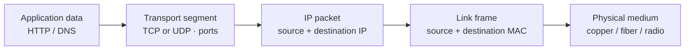
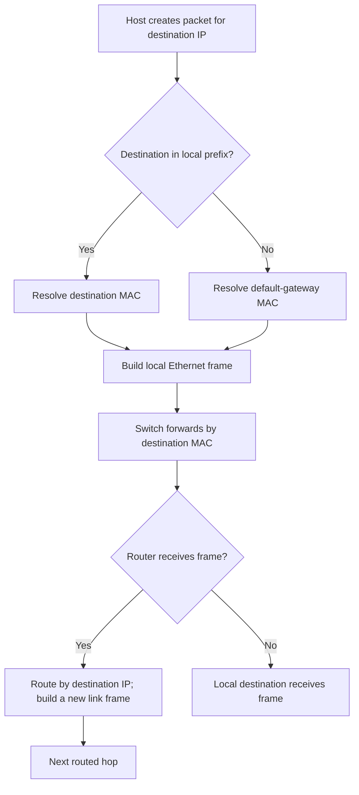

# 02 — Networking: From Ethernet to the Internet

⭐ **Core idea:** follow the packet one hop at a time. A host decides whether the destination is local; if remote, it sends the frame to its default gateway, which routes the IP packet onward.

## 1. Encapsulation and the request path

| Layer model | Examples | Main job |
|---|---|---|
| Application | HTTP(S), DNS, SSH, DHCP | App-level message and semantics. |
| Transport | TCP, UDP | Process-to-process communication using ports. |
| Internet | IPv4, IPv6, ICMP | Addressing and routing between networks. |
| Link | Ethernet, Wi-Fi | Delivery on one local link using link-layer addresses. |

Models such as OSI are learning aids; protocols do not always fit cleanly into a single box.

## 2. Switching, routing, and addressing

- **MAC (Media Access Control) address** identifies a link-layer interface on the local network; switches learn which MAC addresses are reachable on which ports.
- **IP (Internet Protocol) address** identifies an interface in an IP network; routers forward packets between networks using routing tables.
- **Switch** forwards Ethernet frames in a LAN. **Router** forwards IP packets between networks.
- **Default gateway** is the next-hop router a host uses for destinations outside its local subnet.
- **ARP (Address Resolution Protocol)** resolves a local IPv4 next-hop IP to a MAC address. IPv6 uses Neighbor Discovery rather than ARP.
- **VLAN (Virtual LAN)** separates Layer-2 broadcast domains logically. VLANs alone do not enforce secure communication; routing policy/firewall rules must control inter-VLAN traffic.
- **NAT (Network Address Translation)** rewrites address/port information, often to share public IPv4. NAT is not a substitute for firewall policy or authentication.

### Local vs remote destination

The **IP source/destination** usually remain end-to-end across routed hops, subject to NAT; the **link-layer addresses** change at each link.

## 3. IPv4 subnetting (CIDR)

**CIDR (Classless Inter-Domain Routing)** writes a prefix such as `/26`; the prefix length is the number of network bits in a 32-bit IPv4 address.

For ordinary subnets from `/0` to `/30`:

- total addresses = `2^(32 − prefix)`
- commonly usable host addresses = total − 2 (network and broadcast)
- `/31` is commonly used on point-to-point links; `/32` denotes one address. Do not blindly subtract two for these cases.

### Example: `192.168.10.70/26`

1. `/26` mask = `255.255.255.192`; last-octet block size = `256 − 192 = 64`.
2. Blocks start `.0`, `.64`, `.128`, `.192`; `.70` falls in `.64–.127`.
3. Network `.64`, broadcast `.127`, usable range `.65–.126` (62 hosts).
4. A gateway can be any suitable host address reserved by the network plan; it is not required to be the first usable address.

### Fast subnet workflow

`prefix → mask → block size → containing block → network → broadcast → usable range → capacity check`

For a required host count `H`, choose the smallest `h` such that `2^h − 2 ≥ H`; prefix is `32 − h` (for ordinary IPv4 LANs). Include gateways, printers, APs, servers, growth, and reserved addresses in the requirement.

## 4. IPv6, private addressing, and ports

- **IPv6** has 128-bit addresses and no broadcast; multicast and Neighbor Discovery serve related functions. `/64` is common for a LAN subnet, though allocation design depends on the environment.
- RFC 1918 private IPv4 ranges: `10.0.0.0/8`, `172.16.0.0/12`, `192.168.0.0/16`. Private does not mean trusted.
- A **port** identifies a transport-layer endpoint. Common defaults: SSH 22, DNS 53, HTTP 80, HTTPS 443. Ports are conventions and may be changed.
- **ICMP (Internet Control Message Protocol)** carries diagnostics/errors; ping uses ICMP Echo. A blocked ping does not prove the service is down.

## 5. TCP, UDP, MTU, and loss

- **TCP (Transmission Control Protocol)** provides an ordered byte stream with retransmission and congestion control. It does not preserve application message boundaries.
- **UDP (User Datagram Protocol)** provides datagrams without built-in delivery/order guarantees; applications may add their own reliability.
- **MTU (Maximum Transmission Unit)** is the largest link-layer payload a link carries without fragmentation at that layer. Mismatched path MTU can create “small requests work, large transfer stalls” symptoms.
- **Packet loss** triggers retries for some protocols and can sharply reduce throughput; latency and loss often matter more than raw link rate.

## 6. Diagnostic sequence

🧪 Check in order: address/mask/gateway → local link → route → DNS resolution → TCP port reachability → TLS validation → HTTP status/application logs. Use `ipconfig /all`, `route print`, `nslookup example.com`, `Test-NetConnection host -Port 443` (Windows), or `ip address`, `ip route`, `getent hosts example.com`, `curl -Iv https://example.com` (Linux/macOS). These commands contact the named host; use only systems you are authorized to test.

⚠️ A successful ping proves only that an ICMP Echo round trip succeeded at that time. It does not prove DNS, TCP/443, TLS, application health, or data correctness.

## Retrieval questions

1. Which addresses change at a router hop: MAC, IP, or both? What does NAT change?
2. Determine network/broadcast/host range for `10.0.4.77/28`.
3. Why is “VLAN = secure” an incomplete claim?
4. Why can a host reach its gateway but fail to resolve a domain name?
5. What symptoms might an MTU problem create?
