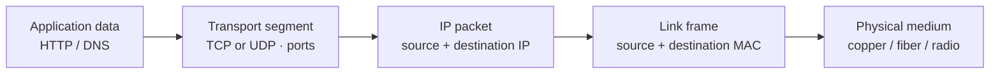
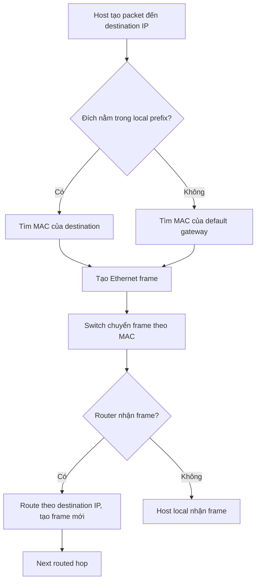
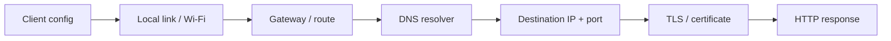

# 02 — Networking: Ethernet đến Internet

> ⭐ **Ý chính:** lần theo packet từng hop một. Host tự xác định đích cùng subnet hay khác subnet; nếu khác, nó gửi frame tới **default gateway**.

## 1. Encapsulation và đường đi dữ liệu

| Layer để dễ học | Ví dụ | Nhiệm vụ |
|---|---|---|
| Application | HTTP(S), DNS, SSH, DHCP | Ý nghĩa request/response ở cấp ứng dụng. |
| Transport | TCP, UDP | Giao tiếp giữa các process thông qua port. |
| Internet | IPv4, IPv6, ICMP | Địa chỉ và định tuyến packet qua nhiều mạng. |
| Link | Ethernet, Wi-Fi | Giao packet trên một local link bằng địa chỉ lớp liên kết. |

OSI là mô hình học tập; một số giao thức thực tế không khớp hoàn toàn vào đúng một ô.

## 2. Switching, routing và địa chỉ

- **MAC (Media Access Control) address** nhận diện interface ở link layer; switch học MAC nào nằm sau port nào.
- **IP (Internet Protocol) address** xác định interface thuộc mạng IP nào; router chuyển packet giữa các mạng theo routing table.
- **Switch** chuyển Ethernet frame trong LAN. **Router** chuyển IP packet giữa các mạng.
- **Default gateway** là router next-hop mà host dùng khi đích nằm ngoài subnet local.
- **ARP (Address Resolution Protocol)** tìm MAC của next-hop IPv4 trong cùng link. IPv6 dùng Neighbor Discovery, không dùng ARP.
- **VLAN (Virtual LAN)** tách broadcast domain ở Layer 2. VLAN tự nó không bảo vệ traffic; cần routing policy/ACL/firewall cho liên lạc giữa VLAN.
- **NAT (Network Address Translation)** đổi địa chỉ/cổng, thường để chia sẻ IPv4 public. NAT không thay firewall hay authentication.

Khi đi qua router, **IP source/destination** thường được giữ nguyên đầu-cuối trừ khi có NAT; **MAC address** thay đổi theo từng link.

## 3. IPv4 subnetting (CIDR)

**CIDR (Classless Inter-Domain Routing)** viết prefix như `/26`; số prefix là số bit dành cho network trong địa chỉ IPv4 32-bit.

Với subnet thông thường `/0` đến `/30`:

- Tổng địa chỉ = `2^(32 − prefix)`
- Host thường dùng = tổng − 2 (network và broadcast)
- `/31` thường dùng cho point-to-point; `/32` là một địa chỉ đơn. Không áp dụng máy móc phép trừ 2 cho hai trường hợp này.

### Ví dụ `192.168.10.70/26`

1. `/26` mask = `255.255.255.192`; block size ở octet cuối = `256 − 192 = 64`.
2. Các block bắt đầu `.0`, `.64`, `.128`, `.192`; `.70` nằm trong `.64–.127`.
3. Network `.64`, broadcast `.127`, host `.65–.126` (62 host).
4. Gateway là host được dành riêng theo thiết kế, **không bắt buộc** phải là host đầu.

**Quy trình tính nhanh:** `prefix → mask → block size → block chứa IP → network → broadcast → host range → kiểm tra capacity`.

Nếu cần `H` host, tìm `h` nhỏ nhất sao cho `2^h − 2 ≥ H`; prefix = `32 − h` (với LAN IPv4 thông thường). Nhớ tính cả gateway, printer, AP, server, thiết bị dự phòng và tăng trưởng.

## 4. IPv6, private IP và port

- **IPv6** có 128 bit, không có broadcast; multicast và Neighbor Discovery đảm nhận các chức năng tương ứng. `/64` phổ biến cho LAN nhưng thiết kế prefix còn tùy môi trường.
- Private IPv4 theo RFC 1918: `10.0.0.0/8`, `172.16.0.0/12`, `192.168.0.0/16`. Private không đồng nghĩa trusted.
- **Port** xác định endpoint ở transport layer. Mặc định thường gặp: SSH 22, DNS 53, HTTP 80, HTTPS 443; dịch vụ có thể cấu hình port khác.
- **ICMP (Internet Control Message Protocol)** dùng cho chẩn đoán/lỗi. Ping dùng ICMP Echo; ping bị chặn không chứng minh service đã chết.

## 5. TCP, UDP, MTU và packet loss

- **TCP (Transmission Control Protocol)** cung cấp byte stream đúng thứ tự, có retransmission và congestion control; TCP không giữ ranh giới message của ứng dụng.
- **UDP (User Datagram Protocol)** gửi datagram, không tự đảm bảo giao nhận/thứ tự; ứng dụng có thể tự xây reliability.
- **MTU (Maximum Transmission Unit)** là payload tối đa của một link mà không cần fragmentation ở link đó. Path MTU sai có thể tạo lỗi “request nhỏ chạy, tải lớn bị treo”.
- **Packet loss** khiến một số protocol phải gửi lại và làm throughput giảm; latency/loss có thể quan trọng hơn tốc độ link ghi trên hộp.

## 6. Troubleshooting theo thứ tự

🧪 Kiểm tra: IP/mask/gateway → local link → route → DNS → TCP port → TLS → HTTP status/app log. Windows: `ipconfig /all`, `route print`, `nslookup example.com`, `Test-NetConnection host -Port 443`. Linux/macOS: `ip address`, `ip route`, `getent hosts example.com`, `curl -Iv https://example.com`. Lệnh cuối có kết nối tới host chỉ định; chỉ kiểm tra hệ thống bạn được phép truy cập.

⚠️ Ping thành công chỉ xác nhận ICMP Echo round trip ở thời điểm đó; không xác nhận DNS, TCP/443, TLS, application health hay tính đúng đắn dữ liệu.

## Câu hỏi tự nhớ

1. Qua router, MAC/IP thay đổi thế nào? NAT thay đổi gì?
2. Tính network/broadcast/host range của `10.0.4.77/28`.
3. Vì sao nói “đã có VLAN là an toàn” chưa đúng?
4. Vì sao ping được gateway mà vẫn không phân giải được domain?
5. MTU problem có thể biểu hiện ra sao?
