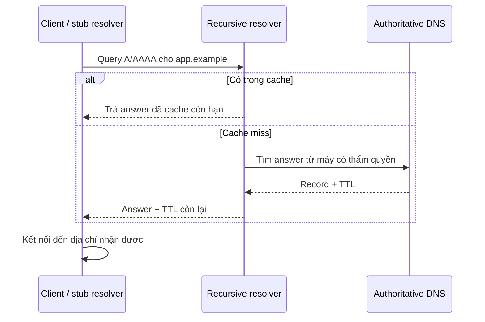

# 03 — Infrastructure Services: DNS, DHCP, Web & Storage

> ⭐ **Ý chính:** các service phụ thuộc lẫn nhau. Hãy debug dependency chain từ client ra ngoài, đừng xem “server” như một thành phần duy nhất.

## 1. DNS: phân giải tên thành record

**DNS (Domain Name System)** là hệ thống tên phân tán. **Stub resolver** trên thiết bị hỏi **recursive resolver**; resolver có thể trả từ cache hoặc truy vấn **authoritative DNS**. DNS có nhiều loại record, không chỉ có IP.

| Record | Công dụng |
|---|---|
| **A** | Tên → địa chỉ IPv4. |
| **AAAA** | Tên → địa chỉ IPv6. |
| **CNAME** | Tên bí danh trỏ tới canonical name khác. |
| **MX** | Mail exchanger của domain. |
| **NS** | Name server có authority cho zone/delegation. |
| **TXT** | Dữ liệu text dùng trong nhiều policy/protocol. |

**TTL (Time to Live)** quy định thời gian cache câu trả lời. Giảm TTL ngay trước khi đổi DNS không xóa cache đã lưu; có thể cần đợi TTL cũ hết hạn. DNS thường dùng UDP, nhưng cũng dùng TCP trong một số trường hợp quy định (ví dụ response lớn hoặc zone transfer).



## 2. DHCP: tự động cấu hình host

**DHCP (Dynamic Host Configuration Protocol)** thường cấp IP, prefix/mask, default gateway, DNS resolver và lease time. Trình tự DHCPv4 thường học là **DORA**: Discover → Offer → Request → Acknowledge. **DHCP relay** chuyển tiếp yêu cầu qua router sang subnet khác; scope không được chồng lấn và IP hạ tầng tĩnh cần được reserve rõ ràng.

⚠️ IP hợp lệ chưa chắc gateway/DNS đúng. So sánh toàn bộ cấu hình với VLAN/subnet dự kiến.

## 3. Một HTTPS request từ đầu đến cuối

```mermaid
sequenceDiagram
  participant B as Browser
  participant D as DNS resolver
  participant E as Edge / load balancer
  participant A as Application
  participant DB as Database / cache
  B->>D: Resolve app.example
  D-->>B: Địa chỉ A/AAAA
  B->>E: Kết nối TCP hoặc QUIC
  B->>E: TLS handshake; kiểm tra certificate và hostname
  B->>E: HTTP request: host/path/headers
  E->>A: Route request; áp dụng health/load policy
  A->>DB: Query hoặc ghi dữ liệu
  DB-->>A: Kết quả
  A-->>E: HTTP response
  E-->>B: Status, headers, body
```

- **HTTP (Hypertext Transfer Protocol)** quy định request/response. HTTP/1.1 và HTTP/2 thường dùng TCP; HTTP/3 dùng QUIC trên UDP.
- **TLS (Transport Layer Security)** xác thực server (và tùy chọn client), thương lượng mã hóa và bảo vệ dữ liệu truyền nếu cấu hình đúng.
- **Certificate validation** kiểm tra trust chain, thời hạn và tên truy cập có khớp không. Có encryption không chứng minh app không có lỗ hổng.
- **Reverse proxy** nhận request phía client rồi chuyển tiếp tới application server; có thể terminate TLS, route theo host/path, giới hạn request.
- **Load balancer** phân phối tải tới backend khỏe mạnh. Health check cần kiểm tra readiness có ý nghĩa, không chỉ “process đang chạy”.
- **Web server** phục vụ static file và/hoặc proxy request động. **Application server** chạy business logic. **Database** lưu state có cấu trúc, query và transaction. Lab nhỏ có thể gộp nhiều vai trò chung máy.

## 4. Storage: block, file, object

| Model | Client nhìn thấy | Dùng thường gặp | Điều cần nhớ |
|---|---|---|---|
| **Block storage** | Volume/device dạng block | OS disk, VM disk, database volume | Filesystem và consistency do lớp trên quản lý. |
| **File storage** | File/folder có tên | Shared folder, home directory | Permission, lock, metadata và network availability. |
| **Object storage** | Object theo key kèm metadata | Ảnh, archive, backup, static content | API khác filesystem thông thường. |
| **DAS / NAS / SAN** | Direct-attached / network file / network block | Local host / chia sẻ file / chia sẻ block | Mô tả kiểu truy cập, không khẳng định đã có backup. |

### RAID đảm bảo availability, không thay backup

| RAID | Dung lượng gần đúng với `n` ổ đều cỡ `S` | Khả năng chịu lỗi ổ | Điểm cần lưu ý |
|---|---:|---|---|
| 0 | `nS` | Không chịu lỗi | Hỏng một ổ có thể mất cả mảng. |
| 1 | `S` với cặp 2 ổ | Một ổ trong cặp | Xóa/sửa nhầm vẫn được mirror. |
| 5 | `(n−1)S`, `n≥3` | Một ổ | Rebuild và lỗi ổ thứ hai là rủi ro. |
| 6 | `(n−2)S`, `n≥4` | Hai ổ | Tốn dung lượng và thời gian rebuild. |
| 10 | `nS/2`, n chẵn ≥4 | Tùy cặp mirror | Có thể chịu nhiều ổ nếu chúng không cùng cặp. |

## 5. Backup và phục hồi

- **Backup** là bản sao có thể phục hồi và được bảo vệ khỏi các lỗi của production. Phân tách credential và failure domain rất quan trọng.
- **Snapshot** là góc nhìn dữ liệu tại một thời điểm, thường vẫn phụ thuộc cùng hệ thống storage; snapshot đơn lẻ có thể không sống sót khi mất cả account/site.
- **Full / incremental / differential:** sao toàn bộ / thay đổi từ lần sao gần nhất / thay đổi từ full gần nhất.
- **Quy tắc 3-2-1:** 3 bản sao, 2 loại thiết bị/phương tiện, 1 bản ngoài site chính. Tùy threat model mà thêm immutable/offline copy chống ransomware.
- **RPO (Recovery Point Objective):** lượng mất dữ liệu tối đa chấp nhận, đo theo thời gian. **RTO (Recovery Time Objective):** thời gian mục tiêu để khôi phục dịch vụ.
- Chỉ chứng minh được backup khi đã thử restore và xác minh. Tính cả credential, key, dependency, consistency của ứng dụng và thứ tự khôi phục.

🧪 Ví dụ: recovery point mỗi giờ chỉ hỗ trợ RPO gần một giờ nếu bản sao chạy thành công thường xuyên và được giám sát. RTO hai giờ phải tính phát hiện sự cố, cấp máy, restore data, mở dependency và kiểm tra dịch vụ—không chỉ tốc độ copy.

## Câu hỏi tự nhớ

1. Kể đường đi từ nhập URL tới trang web; nêu ít nhất 5 điểm có thể hỏng.
2. Vì sao người dùng khác nhau có thể thấy DNS answer khác nhau?
3. Vì sao TLS không chứng minh app không có vulnerability?
4. Chọn storage model cho VM disk, shared folder và image archive.
5. Thiết kế restore test chứng minh RPO/RTO, không chỉ xác nhận có file backup.
