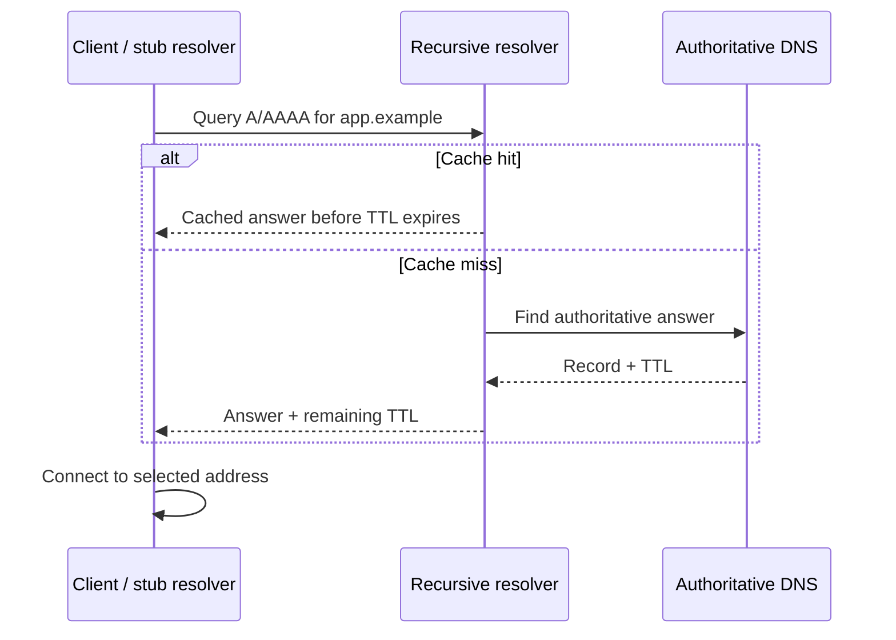

# 03 — Infrastructure Services: DNS, DHCP, Web, Storage

⭐ **Core idea:** services depend on other services. Debug the dependency chain from the client outward instead of assuming “the server” is one thing.

## 1. DNS: names to records

**DNS (Domain Name System)** is a distributed naming system. A stub resolver asks a recursive resolver; the resolver may use cache or query authoritative DNS. DNS records are not all “IP records.”

| Record | Purpose |
|---|---|
| **A** | Name to IPv4 address. |
| **AAAA** | Name to IPv6 address. |
| **CNAME** | Alias to another canonical name. |
| **MX** | Mail exchanger for a domain. |
| **NS** | Delegated authoritative name server. |
| **TXT** | Text data used by multiple protocols/policies. |

**TTL (Time to Live)** controls how long a DNS answer can be cached. Lowering TTL shortly before a change does not erase already-cached answers; wait for old TTLs where required. DNS commonly uses UDP and also TCP in defined cases (for example, larger responses or zone transfers).



## 2. DHCP: automatic host configuration

**DHCP (Dynamic Host Configuration Protocol)** commonly supplies an address, prefix/mask, default gateway, DNS resolver, and lease time. DHCPv4’s familiar DORA sequence is Discover → Offer → Request → Acknowledge. A DHCP relay forwards requests across routed networks; keep scopes non-overlapping and reserve static infrastructure addresses deliberately.

⚠️ A valid address does not guarantee correct gateway or DNS. Compare the full configuration with the intended subnet/VLAN.

## 3. One HTTPS request, end to end

```mermaid
sequenceDiagram
  participant B as Browser
  participant D as DNS resolver
  participant E as Edge / load balancer
  participant A as Application
  participant DB as Database / cache
  B->>D: Resolve app.example
  D-->>B: Address (A/AAAA)
  B->>E: TCP or QUIC connection to service
  B->>E: TLS handshake; validate certificate and name
  B->>E: HTTP request with Host/path/headers
  E->>A: Route request; apply health/load policy
  A->>DB: Query or update data
  DB-->>A: Result
  A-->>E: HTTP response
  E-->>B: Status, headers, body
```

- **HTTP (Hypertext Transfer Protocol)** defines request/response semantics. HTTP/1.1 and HTTP/2 are commonly carried over TCP; HTTP/3 uses QUIC over UDP.
- **TLS (Transport Layer Security)** authenticates the server (and optionally client), negotiates cryptographic protection, and protects data in transit when correctly configured.
- **Certificate validation** checks trust chain, validity, and that the requested name matches. Encryption alone does not make an application safe or private from its endpoint.
- **Reverse proxy** accepts client requests and forwards to application servers; it may terminate TLS, route by hostname/path, and enforce limits.
- **Load balancer** distributes work across healthy backends; health checks must represent actual readiness, not merely “process exists.”
- **Web server** may serve static assets and/or proxy dynamic requests. **Application server** executes business logic. **Database** stores structured state and supports queries/transactions. These roles may be combined in a small lab.

## 4. Storage: block, file, and object

| Model | What the client sees | Common use | Key consideration |
|---|---|---|---|
| **Block storage** | Raw volume/device blocks | OS disk, VM disk, database volume | Filesystem and consistency are managed above the block device. |
| **File storage** | Named directories/files | Shared folders, home directories | Permissions, locking, metadata, and network availability matter. |
| **Object storage** | Objects addressed by keys with metadata | Media, archives, backups, static content | API semantics differ from a normal mounted filesystem. |
| **DAS / NAS / SAN** | Direct-attached / network file / network block storage | Host-local / shared files / shared block | Labels describe access architecture, not backup guarantees. |

### RAID is availability, not backup

| Level | Approx. usable capacity for `n` equal drives of size `S` | Typical drive-failure property | Main caveat |
|---|---:|---|---|
| RAID 0 | `nS` | None | Any member failure can lose the array. |
| RAID 1 | `S` for a two-drive mirror | One member can fail | Deletion/corruption is mirrored too. |
| RAID 5 | `(n−1)S`, `n≥3` | One member | Rebuild and a second failure are risks. |
| RAID 6 | `(n−2)S`, `n≥4` | Two members | Rebuild/time/capacity cost. |
| RAID 10 | `nS/2`, even `n≥4` | Depends on mirror pairs | Multiple failures may be survivable only if in different pairs. |

## 5. Backup and restore engineering

- **Backup** is a recoverable copy protected from the failure modes of production. Separate credentials and failure domains matter.
- **Snapshot** is a point-in-time view, often on the same storage system; a snapshot alone may not survive system/account/site loss.
- **Full / incremental / differential**: copy everything / changes since prior backup / changes since last full backup.
- **3-2-1 rule**: keep 3 copies, across 2 media/types, with 1 off-site (adapt for threat model; immutable/offline copies help against ransomware).
- **RPO (Recovery Point Objective)**: maximum acceptable data loss measured in time. **RTO (Recovery Time Objective)**: target duration to restore service.
- A backup is not proven until a restore has been tested and verified. Include credentials, keys, dependencies, application consistency, and recovery ordering.

🧪 Example: hourly recovery points may support an RPO near one hour only if successful copies are frequent and monitored. A two-hour RTO must include detection, provisioning, data restore, dependency startup, and validation—not just copy speed.

## Retrieval questions

1. Trace what happens from entering a URL to seeing a page; name at least five failure points.
2. Why may a DNS change appear inconsistent across users?
3. Explain why TLS does not prove an app is vulnerability-free.
4. Which storage model would you select for a VM disk, team share, and image archive?
5. Design a restore test that demonstrates an RPO and RTO rather than merely checking that a backup file exists.
