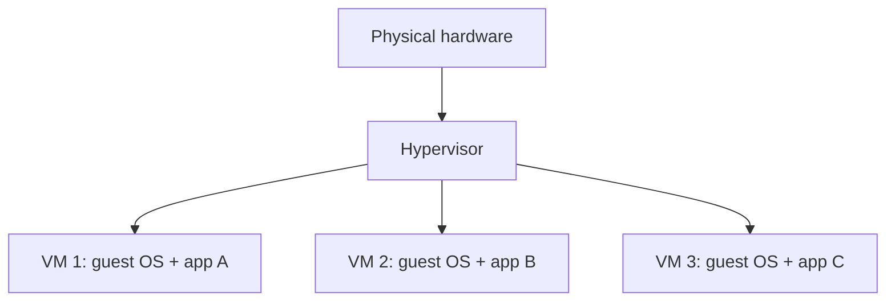
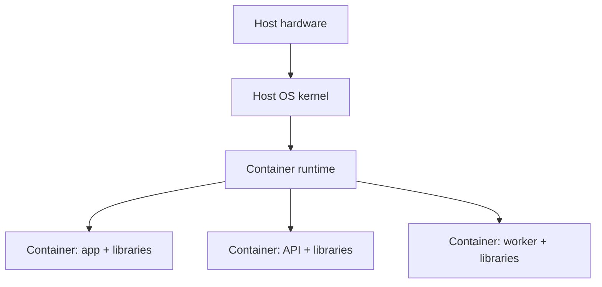

# 04 — Virtualization, Containers, and Cloud

⭐ **Core idea:** these technologies package and allocate resources differently. Choose based on workload, isolation, operations, portability, and cost—not hype.

## 1. Virtual machines

**Virtualization** presents virtual hardware to guest operating systems. A **hypervisor** manages virtual machines (VMs); Type 1 runs on/near hardware, while Type 2 runs over a host OS (the terminology is a simplified model).

VMs provide separate guest kernels and flexible OS choices, with more memory/storage overhead and slower startup than lightweight process isolation in many setups. VM boundaries still need patching, identity, network controls, and secure images.

## 2. Containers

A **container** packages an application and user-space dependencies while sharing the host kernel in common container models. Linux namespaces isolate views; cgroups constrain/account resources. Containers are not tiny VMs and should not be assumed to be a complete security boundary.

**Image** is a packaged template; **container** is a running instance. **Registry** stores/distributes images. **Volume** persists data beyond a container lifecycle. **Compose** describes a multi-container application and its configuration. Docker uses a client/server architecture: the client sends API requests to a daemon that manages images, containers, networks, and volumes.

🧪 Local safe workflow: inspect the Dockerfile and image source → pin/verify image version → build/run only trusted code → expose only required ports → use a named volume for data → inspect logs/health → stop and remove the lab resources. Never mount a sensitive host directory or pass production secrets into an untrusted image.

## 3. VM vs container

| Question | VM tends to fit when… | Container tends to fit when… |
|---|---|---|
| Kernel/OS | Workload needs a different guest kernel or full OS environment. | Workloads can share a compatible host kernel. |
| Packaging | You need a machine image with OS services and app. | You need repeatable application/runtime packaging. |
| Density/startup | Stronger guest separation matters more than startup/density. | Fast deployment and efficient process-level packaging matter. |
| Operations | Teams manage VM images, patching, and guest OS lifecycle. | Teams manage image provenance, runtime policy, orchestration, and persistent state. |
| Security | VM boundary may help separate trust domains. | Requires careful kernel/runtime hardening and least privilege; isolation is not automatic. |

They are often combined: containers run inside VMs, and cloud services may hide both layers from the customer.

## 4. Cloud service and deployment models

| Model | Provider generally operates | Customer still owns |
|---|---|---|
| **IaaS (Infrastructure as a Service)** | Physical data center and virtualization fabric. | Guest OS patching, identity, app, data, many network controls. |
| **PaaS (Platform as a Service)** | Infrastructure plus managed application runtime/platform. | App code, data, identities, configuration, service-specific controls. |
| **SaaS (Software as a Service)** | Hosted application and most underlying stack. | Users, access policy, data governance, endpoint and tenant configuration. |
| **FaaS / serverless** | Event-driven runtime and much of server management. | Function code, permissions, data, event/configuration, cost limits. |

Exact boundaries vary by provider/service; use the service’s responsibility matrix. **Cloud is not automatically cheaper, safer, or more available.** Include compute, storage, data egress, requests, licenses, support, monitoring, backup, and staff time in total cost.

## 5. Availability and deployment patterns

- **Single instance**: simple and cheap, but a host/process failure can interrupt service.
- **Active-passive**: standby takes over; test failover and data consistency.
- **Active-active**: multiple instances serve traffic; requires routing, health checks, shared/partitioned state, and careful failure handling.
- **Availability zone/region**: provider-defined failure domains; confirm what is independent and what remains shared.
- **RPO/RTO** remain application-level outcomes; buying a second region does not prove recovery works.

## 6. Practical design decision record

For every deployment, write down:

1. **Workload:** CPU/memory/I/O/network shape, peak concurrency, state, data sensitivity.
2. **Constraints:** latency, availability, RPO/RTO, supported OS/kernel, budget, skills.
3. **Choice and rejected alternatives:** VM, container, managed platform, or physical host, with reasons.
4. **Operations:** image/patch updates, secrets, logs/metrics, backups, rollback, ownership.
5. **Evidence:** a test showing performance, isolation, recovery, and cost assumptions.

## Retrieval questions

1. Why is a container not simply a “small VM”?
2. Where is persistent container data stored and why?
3. In SaaS, what security responsibilities still belong to the customer?
4. Give one reason to run containers inside VMs.
5. What costs are easy to omit from a cloud estimate?
