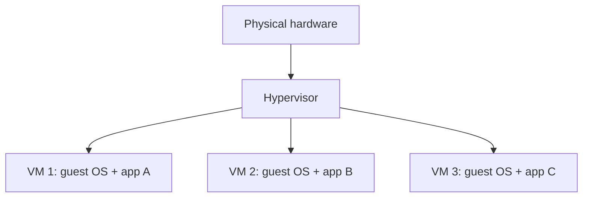
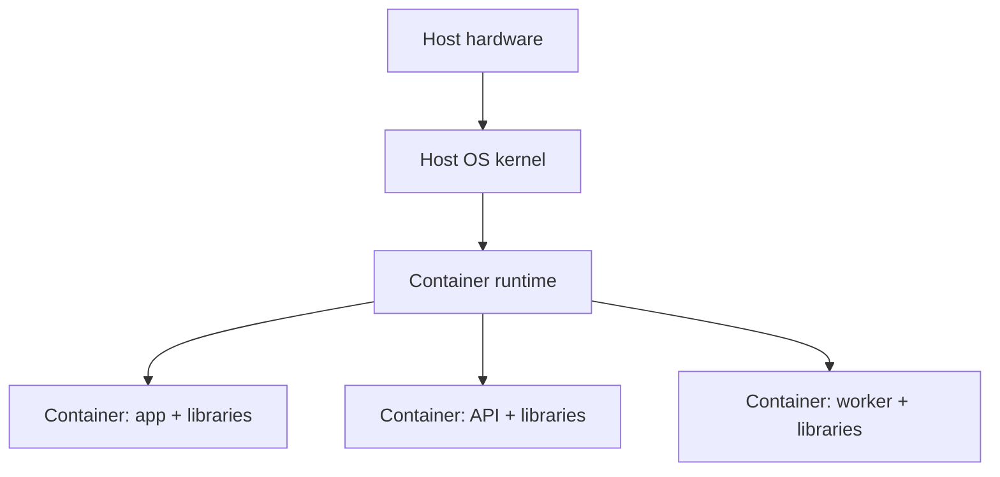

# 04 — Virtualization, Containers & Cloud

> ⭐ **Ý chính:** mỗi công nghệ đóng gói và chia tài nguyên khác nhau. Chọn theo workload, isolation, vận hành, portability và chi phí—not theo hype.

## 1. Virtual Machine

**Virtualization** tạo hardware ảo cho **VM (Virtual Machine)**. **Hypervisor** quản lý các VM. Mô hình Type 1 chạy gần/trên hardware; Type 2 chạy trên host OS (đây là mô hình hóa đơn giản để học).

Mỗi VM có guest OS/kernel riêng, hợp khi cần OS khác nhau hoặc môi trường máy đầy đủ. Đổi lại, thường cần nhiều memory/storage hơn và boot lâu hơn kiểu process isolation. VM vẫn phải được patch, cấp identity, giới hạn network và quản lý image.

## 2. Container

**Container** đóng gói ứng dụng và user-space dependencies nhưng trong mô hình phổ biến sẽ **dùng chung host kernel**. Trên Linux, namespaces tách góc nhìn của process và cgroups giới hạn/theo dõi tài nguyên. Container không phải VM thu nhỏ và không nên mặc định là security boundary hoàn chỉnh.

- **Image** là template đã đóng gói; **container** là instance đang chạy.
- **Registry** lưu và phân phối image.
- **Volume** giữ dữ liệu qua vòng đời container.
- **Compose** mô tả ứng dụng gồm nhiều container và cấu hình liên quan.
- Docker dùng client/server architecture: client gửi API request đến daemon; daemon quản lý images, containers, networks và volumes.

🧪 Workflow lab an toàn: xem Dockerfile và nguồn image → pin/kiểm tra version → chỉ build/run code tin cậy → chỉ expose port cần → dùng volume riêng cho dữ liệu → xem logs/health → dừng và xóa đúng tài nguyên lab. Không mount thư mục nhạy cảm, không đưa production secret vào image lạ. Tham khảo [Docker architecture chính thức](https://docs.docker.com/get-started/docker-overview/).

## 3. VM hay container?

| Câu hỏi | VM hợp hơn khi… | Container hợp hơn khi… |
|---|---|---|
| Kernel/OS | Cần guest kernel hoặc OS khác. | Workload tương thích với host kernel. |
| Đóng gói | Cần machine image có OS service + app. | Cần package runtime/app nhất quán. |
| Startup/density | Isolation của guest quan trọng hơn density. | Muốn triển khai nhanh, gọn. |
| Vận hành | Team quản lý VM image, guest OS, patch. | Team quản lý image provenance, runtime policy, orchestration, state. |
| Security | VM boundary có thể tách trust domain. | Cần harden host kernel/runtime và least privilege; isolation không tự có. |

Có thể kết hợp: container chạy bên trong VM, hoặc cloud service ẩn cả hai lớp với khách hàng.

## 4. Cloud service model

| Model | Provider thường vận hành | Customer vẫn chịu trách nhiệm |
|---|---|---|
| **IaaS (Infrastructure as a Service)** | Data center vật lý và virtualization fabric. | Guest OS patch, identity, app/data, nhiều network control. |
| **PaaS (Platform as a Service)** | Hạ tầng và application runtime/platform quản lý sẵn. | App code, data, identity, cấu hình và các control riêng của service. |
| **SaaS (Software as a Service)** | Ứng dụng hosted và phần lớn stack bên dưới. | User/access policy, data governance, endpoint và tenant config. |
| **FaaS / serverless** | Runtime event-driven và phần lớn server management. | Function code, permission, data, event/config và giới hạn chi phí. |

Ranh giới chính xác tùy provider/service; xem responsibility matrix của từng dịch vụ. **Cloud không mặc định rẻ hơn, an toàn hơn hay sẵn sàng hơn.** Tính compute, storage, egress, request, license, support, monitoring, backup và giờ công.

## 5. Availability pattern

- **Single instance:** đơn giản/rẻ nhưng lỗi host/process có thể làm dịch vụ dừng.
- **Active-passive:** standby takeover; phải test failover và consistency dữ liệu.
- **Active-active:** nhiều instance nhận traffic; cần routing, health check, xử lý state và failure cẩn thận.
- **Availability zone/region:** failure domain do provider định nghĩa; xác minh thành phần nào thực sự độc lập và còn dependency chung nào.
- **RPO/RTO** là kết quả ở cấp ứng dụng; có hai region không tự chứng minh phục hồi được.

## 6. Decision record cho thiết kế

Với mỗi cách deploy, ghi lại:

1. **Workload:** CPU/RAM/I/O/network, peak concurrency, state, độ nhạy dữ liệu.
2. **Ràng buộc:** latency, availability, RPO/RTO, OS/kernel được hỗ trợ, budget, kỹ năng team.
3. **Lựa chọn và phương án bị loại:** VM, container, managed platform hay physical host; nêu lý do.
4. **Vận hành:** image/patch, secret, logs/metrics, backup, rollback, owner.
5. **Evidence:** phép thử performance, isolation, recovery và giả định cost.

## Câu hỏi tự nhớ

1. Vì sao container không đơn giản là “VM nhỏ”?
2. Dữ liệu persistent của container nằm đâu và vì sao?
3. Dùng SaaS thì khách hàng vẫn cần bảo vệ điều gì?
4. Nêu một lý do chạy container bên trong VM.
5. Chi phí cloud nào hay bị bỏ sót?
