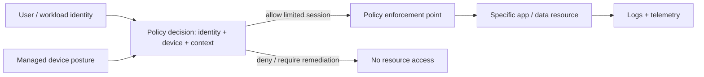
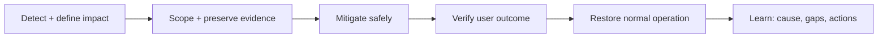
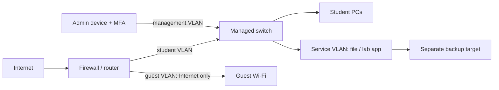

# 05 — Security, Operations, and Infrastructure Design

⭐ **Core idea:** design for expected failure. Reduce the chance and impact of compromise, make failures observable, and prove that recovery meets the service objective.

## 1. Security foundations

- **CIA triad:** Confidentiality (only authorized disclosure), Integrity (correctness/unauthorized change protection), Availability (accessible when required).
- **Least privilege:** give each identity only the actions/resources needed, for only as long as needed.
- **MFA (Multi-Factor Authentication):** combine independent factor types; two passwords are not two factors.
- **RBAC (Role-Based Access Control):** assign permissions to roles, then users/service identities to roles.
- **ACL (Access Control List):** explicit subject/action/resource rules.
- **Encryption at rest / in transit:** protect stored data / data moving across a channel. Manage keys and certificates; encryption does not prevent authorized endpoint misuse.
- **Secret:** credential, API key, token, or private key. Keep it out of source control, logs, screenshots, and shared docs; use a secret manager and rotation process.
- **Patch and vulnerability management:** inventory → prioritize by exposure/impact → test → deploy → verify → track exceptions.
- **Segmentation:** restrict communication paths to contain compromise; do not rely on “internal network” as trust proof.

### Zero Trust (ZT) as a design principle

**Zero Trust Architecture (ZTA)** removes implicit trust based solely on network location or ownership. Authenticate/authorize subject and device for access to a resource; evaluate context and limit access. It is not a product switch or a requirement to distrust every packet equally.

## 2. Threat modeling and secure architecture

Use a simple repeatable pass:

1. **Assets:** identities, endpoints, network, application, data, backups, management plane.
2. **Trust boundaries:** public/private edge, user/admin, app/database, tenant/account, production/backup.
3. **Threats:** unauthorized access, data exposure, tampering, denial of service, credential theft, lateral movement, accidental deletion.
4. **Controls:** prevent, detect, respond, recover. Map each threat to a control and owner.
5. **Residual risk:** record what remains and how it will be accepted/monitored.

⚠️ Avoid security theater: a firewall rule is not useful if a public admin interface remains reachable through another path; MFA is weakened by shared accounts; a backup is vulnerable if attackers can delete it with production credentials.

## 3. Observe and operate

| Signal | What it answers | Example |
|---|---|---|
| **Metrics** | How much / how often / how long? | Request rate, p95 latency, error ratio, disk free. |
| **Logs** | What event happened, with context? | Auth denied, service restart, deployment ID. |
| **Traces** | Where did one request spend time across services? | Gateway 20 ms, app 80 ms, DB 900 ms. |
| **Events** | What changed in the environment? | Config rollout, node replacement, certificate renewal. |

**SLO (Service Level Objective)** is a target for a service indicator over a window; **SLI (Service Level Indicator)** is the measured indicator; **SLA (Service Level Agreement)** is an external commitment/contract. Define the user-visible measurement and exclusions precisely.

**p95 latency**: 95% of observations are at or below this value (5% are higher). Average latency can hide painful tail delays. Alert on symptoms and actionable causes, not every noisy metric. Protect logs from secrets and excessive personal data.

Availability is often approximated as `uptime / (uptime + downtime)` over a stated window. For 30 days, 99.9% allows about 43.2 minutes of downtime. A chain of two independent 99.9%-available serial components is approximately 99.8001%; independence is a strong assumption and shared dependencies can worsen it.

## 4. Incident response and change safety

### Incident runbook

For a suspected web outage, check from outside inward: DNS answer → route/reachability → TCP port → TLS/certificate → HTTP status → proxy/app health → database/dependency → recent changes. Preserve relevant logs and timestamps. Mitigation can precede root-cause proof when impact is high, but record what changed.

### Change record checklist

- Goal, scope, owner, and user impact
- Preconditions and backup/snapshot where appropriate
- Exact steps and expected observations
- Validation including user-visible check
- Rollback trigger and tested rollback path
- Monitoring window and communication

## 5. Capacity and infrastructure design

Start with requirements, not a brand/model:

| Requirement | Questions |
|---|---|
| Users/workload | Peak concurrent users? Request size/rate? Batch windows? Growth? |
| Performance | Target p95 latency and throughput? Which dependency dominates? |
| Availability | Required service hours? Failure domains? Maintenance tolerance? |
| Data | Sensitivity, retention, integrity, growth, RPO, RTO? |
| Operations | Who patches, monitors, restores, and approves changes? |
| Cost | Capital/cloud, licenses, egress, backup, support, staff, power/cooling? |

**Back-of-the-envelope examples:**

- Storage required ≈ active data + indexes/metadata + logs + retained backups + growth + free-space headroom. Avoid assuming compression/deduplication until measured.
- Network throughput ≈ concurrent active clients × average per-client rate, then account for bursts, protocol overhead, and shared links.
- CPU needs depend on per-request work and parallelism; benchmark representative workload rather than translating user count directly into vCPU.

### Example: small teaching lab

Write explicit policy, e.g. guest → Internet only; students → approved lab services; admin → management interfaces; service → backup target on required ports only. Deny by default where practical, then permit and test necessary flows. The exact design depends on assignment requirements and threat model.

## 6. Retrieval and design exercise

1. For a student portal, list assets, trust boundaries, one threat per boundary, and a control.
2. The site is “up” but p95 latency and error ratio rise. Which signals and dependencies do you inspect?
3. Propose an RPO/RTO, then list the steps and evidence needed to prove each.
4. Draw a VLAN policy for student, guest, server, and admin networks; list allowed flows.
5. Identify a single point of failure in your drawing and propose a proportionate mitigation.
