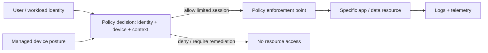
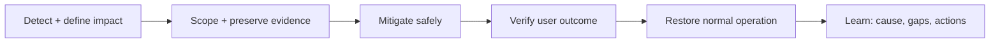
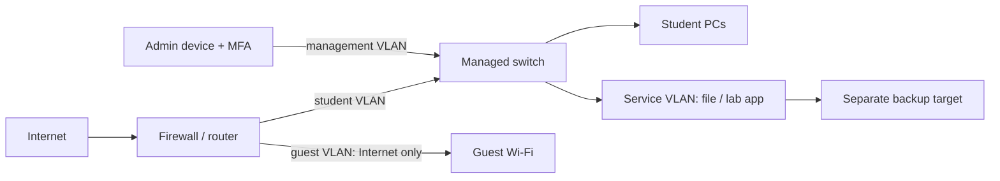

# 05 — Security, Operations & Infrastructure Design

> ⭐ **Ý chính:** thiết kế để hệ thống chịu được lỗi. Giảm nguy cơ/tác động của sự cố, quan sát được vấn đề và chứng minh việc phục hồi đáp ứng mục tiêu.

## 1. Nền tảng security

- **CIA triad:** Confidentiality (chỉ người được phép xem), Integrity (bảo vệ tính đúng và chống thay đổi trái phép), Availability (dùng được khi cần).
- **Least privilege:** chỉ cấp identity đúng quyền, đúng resource, đúng thời gian cần.
- **MFA (Multi-Factor Authentication):** kết hợp các loại yếu tố độc lập; hai mật khẩu vẫn chỉ là cùng một loại factor.
- **RBAC (Role-Based Access Control):** gán quyền cho role, rồi gán user/service identity vào role.
- **ACL (Access Control List):** rule chỉ rõ subject/action/resource nào được cho phép hoặc từ chối.
- **Encryption at rest / in transit:** bảo vệ data lưu trữ / data đang truyền. Phải quản lý key; encryption không ngăn endpoint được cấp quyền lạm dụng dữ liệu.
- **Secret:** password, API key, token, private key. Không commit vào source, logs, ảnh chụp hay tài liệu chia sẻ; dùng secret manager và có quy trình rotation.
- **Patch/vulnerability management:** inventory → ưu tiên theo exposure/impact → test → deploy → verify → theo dõi ngoại lệ.
- **Segmentation:** giới hạn đường đi để khoanh vùng sự cố; đừng coi “internal network” là bằng chứng đáng tin.

### Zero Trust như một nguyên tắc thiết kế

**Zero Trust Architecture (ZTA)** bỏ mặc định tin cậy chỉ vì thiết bị ở trong mạng nội bộ hoặc thuộc sở hữu tổ chức. Xác thực/ủy quyền user và device trước khi truy cập resource; đánh giá context và giới hạn phạm vi truy cập. Đây là cách thiết kế, không phải một sản phẩm bật lên là xong.

Nguồn chuẩn: [NIST SP 800-207 — Zero Trust Architecture](https://csrc.nist.gov/pubs/sp/800/207/final).

## 2. Threat modeling và secure architecture

1. **Assets:** identity, endpoint, network, app, data, backup, management plane.
2. **Trust boundaries:** public/private edge, user/admin, app/database, tenant/account, production/backup.
3. **Threats:** truy cập trái phép, lộ dữ liệu, sửa dữ liệu, denial of service, đánh cắp credential, lateral movement, xóa nhầm.
4. **Controls:** prevent, detect, respond, recover. Gắn từng threat với control và người chịu trách nhiệm.
5. **Residual risk:** ghi phần rủi ro còn lại, owner và cách theo dõi/chấp nhận.

⚠️ Tránh security theater: firewall rule không giúp nếu admin interface còn public qua đường khác; MFA mất ý nghĩa khi dùng chung account; backup có thể bị xóa nếu attacker dùng được credential production.

## 3. Observability: metrics, logs, traces

| Tín hiệu | Trả lời câu hỏi | Ví dụ |
|---|---|---|
| **Metrics** | Bao nhiêu / thường xuyên thế nào / mất bao lâu? | Request rate, p95 latency, error ratio, disk free. |
| **Logs** | Sự kiện nào xảy ra, kèm ngữ cảnh gì? | Auth denied, service restart, deployment ID. |
| **Traces** | Một request tốn thời gian ở service nào? | Gateway 20 ms, app 80 ms, DB 900 ms. |
| **Events** | Hệ thống vừa thay đổi gì? | Config rollout, node replacement, certificate renewal. |

- **SLI (Service Level Indicator):** chỉ số đo dịch vụ.
- **SLO (Service Level Objective):** mục tiêu cho SLI trong một khoảng thời gian.
- **SLA (Service Level Agreement):** cam kết/thỏa thuận dịch vụ với bên ngoài.

**p95 latency** là ngưỡng mà 95% kết quả đo bằng hoặc thấp hơn; 5% còn lại chậm hơn. Average có thể che tail latency gây khó chịu cho user. Alert nên dựa trên triệu chứng và nguyên nhân có thể xử lý, không phải mọi metric ồn. Không ghi secret hoặc quá nhiều thông tin cá nhân vào log.

Availability thường ước lượng: `uptime / (uptime + downtime)` trong một cửa sổ xác định. 30 ngày với 99.9% tương đương khoảng 43.2 phút downtime. Hai dependency nối tiếp, mỗi cái 99.9% và độc lập, cho tổng khoảng 99.8001%; giả định độc lập thường không hoàn toàn đúng vì có shared dependency.

## 4. Incident response và thay đổi an toàn

### Runbook khi web lỗi

Kiểm tra từ ngoài vào trong: DNS answer → route/connectivity → TCP port → TLS/certificate → HTTP status → proxy/app health → database/dependency → thay đổi mới nhất. Giữ log và timestamp liên quan. Nếu impact cao, mitigation có thể đi trước khi biết root cause, nhưng phải ghi lại đã thay đổi gì.

### Change record checklist

- Mục tiêu, phạm vi, owner, ảnh hưởng user
- Điều kiện trước khi làm; backup/snapshot nếu phù hợp
- Các bước và kết quả dự kiến
- Validation, gồm kiểm tra từ góc nhìn user
- Rollback trigger và đường rollback đã thử
- Thời gian monitor sau thay đổi và thông báo liên quan

## 5. Capacity planning và thiết kế hạ tầng

Bắt đầu từ yêu cầu, không bắt đầu bằng model thiết bị:

| Yêu cầu | Câu hỏi cần trả lời |
|---|---|
| Users/workload | Peak concurrent users? Request rate/size? Batch window? Growth? |
| Performance | p95 latency và throughput mục tiêu? Dependency nào chậm nhất? |
| Availability | Cần phục vụ giờ nào? Failure domain nào? Chấp nhận bảo trì bao lâu? |
| Data | Mức nhạy cảm, retention, integrity, growth, RPO, RTO? |
| Operations | Ai patch, monitor, restore và phê duyệt thay đổi? |
| Cost | Thiết bị/cloud, license, egress, backup, support, nhân sự, điện/làm mát? |

Ước lượng ban đầu:

- `Storage ≈ active data + index/metadata + logs + backup retention + growth + free-space headroom`. Chưa đo thì không tự giả định compression/dedup.
- `Network throughput ≈ concurrent active clients × average rate per client`; cộng burst, protocol overhead và link dùng chung.
- CPU phụ thuộc work trên mỗi request và khả năng song song; benchmark workload đại diện, đừng đổi số user trực tiếp thành số vCPU.

### Ví dụ: phòng lab học tập

Ví dụ policy: guest → Internet; student → dịch vụ lab được duyệt; admin → management interface; service → backup target ở đúng port cần thiết. Mặc định deny khi phù hợp, sau đó permit luồng cần và test. Thiết kế thật phụ thuộc requirement và threat model.

## Bài tập tự nhớ / thiết kế

1. Với student portal, liệt kê assets, trust boundary, một threat mỗi boundary và control.
2. Website vẫn “up” nhưng p95 latency và error ratio tăng: xem signal/dependency nào?
3. Đề xuất RPO/RTO rồi nêu các bước và evidence chứng minh đạt.
4. Vẽ policy VLAN cho student, guest, server, admin; ghi rõ luồng được phép.
5. Tìm single point of failure trong sơ đồ và đề xuất cách giảm rủi ro phù hợp chi phí.
