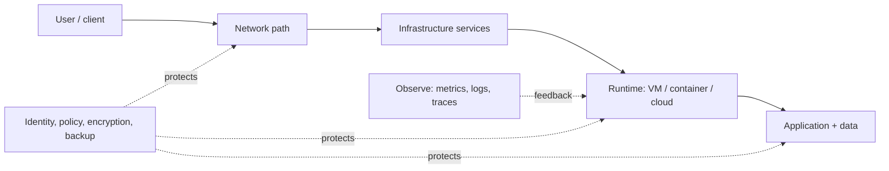

# IE101 Field Notes

> **Learning route:** understand one complete service—from the physical machine to the user request—then learn how to operate, protect, scale, and recover it.

## Read in this order

| Step | Notes | You should be able to… |
|---|---|---|
| 1 | [Computer systems](01-computer-systems.md) | Explain CPU, memory, storage, OS, process, and bottleneck behavior. |
| 2 | [Networking](02-networking.md) | Trace a packet, subnet an IPv4 network, and explain routing and segmentation. |
| 3 | [Infrastructure services](03-infrastructure-services.md) | Trace DNS → connection → TLS → HTTP and distinguish service roles. |
| 4 | [Virtualization, containers & cloud](04-virtualization-containers-cloud.md) | Choose a deployment model and explain its isolation and responsibility boundaries. |
| 5 | [Security, operations & design](05-security-operations-design.md) | Design controls, detect failure, estimate capacity, and recover to an objective. |
| 6 | [Acronym glossary](06-acronym-glossary.md) | Expand and use the abbreviations seen throughout the course. |

## How to study each note

1. Read the diagram and explain it aloud without looking.
2. Recreate the diagram from memory; label each arrow with a protocol or data flow.
3. Run the safe lab/check commands and record the expected versus observed result.
4. Answer the **retrieval questions** at the end of each topic from memory.
5. Finish with [course exercises](../02-bai-tap.md) and the [review sheet](../03-on-tap.md).

**Priority markers:** ⭐ core concept · 🧪 practical check · ⚠️ common misconception · 🔎 advanced design consideration.

**Scope note:** these are English-first expanded notes for self-study. They complement—but do not replace—the instructor’s current syllabus, slides, lab environment, or exam scope. See [course references](../04-tai-lieu.md).
