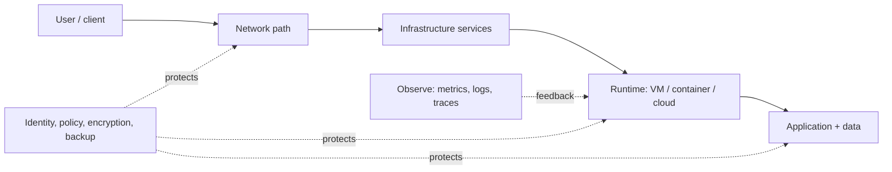

# IE101 Field Notes — Mục lục

> **Lộ trình:** theo một request xuyên suốt — từ máy của user, qua hạ tầng đến ứng dụng; sau đó học cách vận hành, bảo vệ, mở rộng và phục hồi hệ thống.

Thuật ngữ và acronym giữ bằng English để quen từ chuyên ngành; phần giải thích, ví dụ và câu hỏi được viết bằng tiếng Việt.

## Học theo thứ tự

| Bước | Ghi chú | Sau phần này, bạn có thể… |
|---|---|---|
| 0 | [History timeline: máy tính, tương tác, Internet](00-history-computing-ui-internet.md) | Giải thích vấn đề khiến công nghệ ra đời; phân biệt Internet và Web. |
| 1 | [Computer systems](01-computer-systems.md) | Giải thích CPU, memory, storage, OS, process và bottleneck. |
| 2 | [Networking](02-networking.md) | Lần theo packet, tính subnet IPv4, giải thích routing và segmentation. |
| 3 | [Infrastructure services](03-infrastructure-services.md) | Lần theo DNS → connection → TLS → HTTP; phân biệt vai trò service. |
| 4 | [Virtualization, containers & cloud](04-virtualization-containers-cloud.md) | Chọn deployment model và giải thích isolation/trách nhiệm. |
| 5 | [Security, operations & design](05-security-operations-design.md) | Thiết kế control, phát hiện lỗi, ước lượng capacity và phục hồi. |
| 6 | [Acronym glossary](06-acronym-glossary.md) | Mở rộng và sử dụng acronym trong các chủ đề. |

## Cách học mỗi ghi chú

1. Nhìn sơ đồ, tự giải thích lại bằng lời mà không nhìn phần chữ.
2. Vẽ lại sơ đồ từ trí nhớ, ghi protocol/data flow trên từng mũi tên.
3. Làm lab/đọc lệnh an toàn, ghi lại kết quả dự kiến và thực tế.
4. Trả lời **câu hỏi tự nhớ** cuối mỗi chủ đề.
5. Làm tiếp [bài tập môn học](../02-bai-tap.md) và [phiếu ôn tập](../03-on-tap.md).

**Ký hiệu:** ⭐ khái niệm cốt lõi · 🧪 thực hành · ⚠️ hiểu lầm hay gặp · 🔎 điểm thiết kế nâng cao.

**Phạm vi:** đây là ghi chú tự học mở rộng. Đối chiếu nội dung thi với đề cương, bài giảng, lab và LMS của giảng viên; xem [nguồn môn học](../04-tai-lieu.md).
