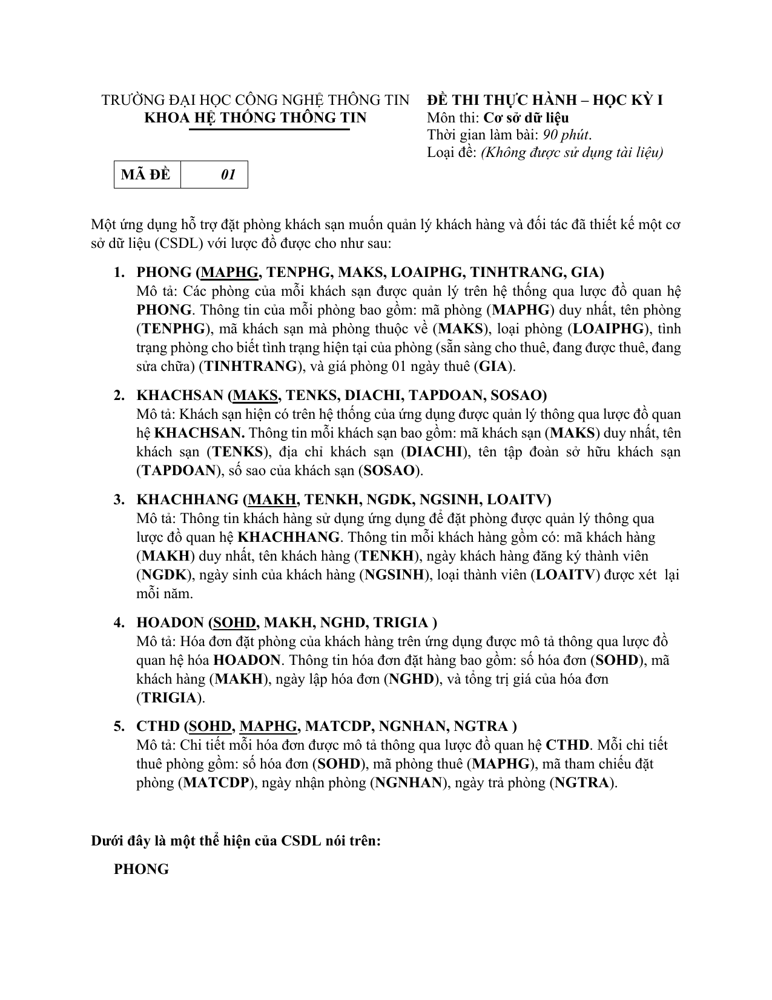
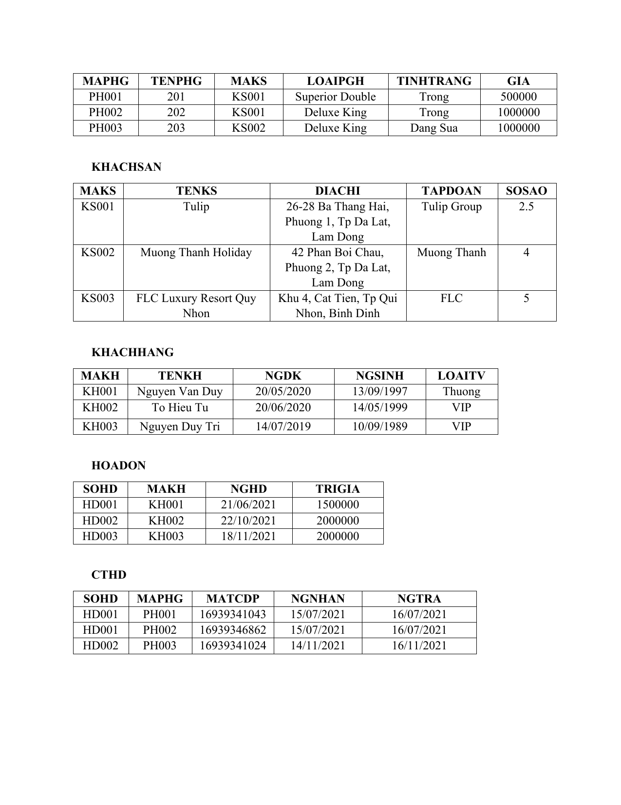
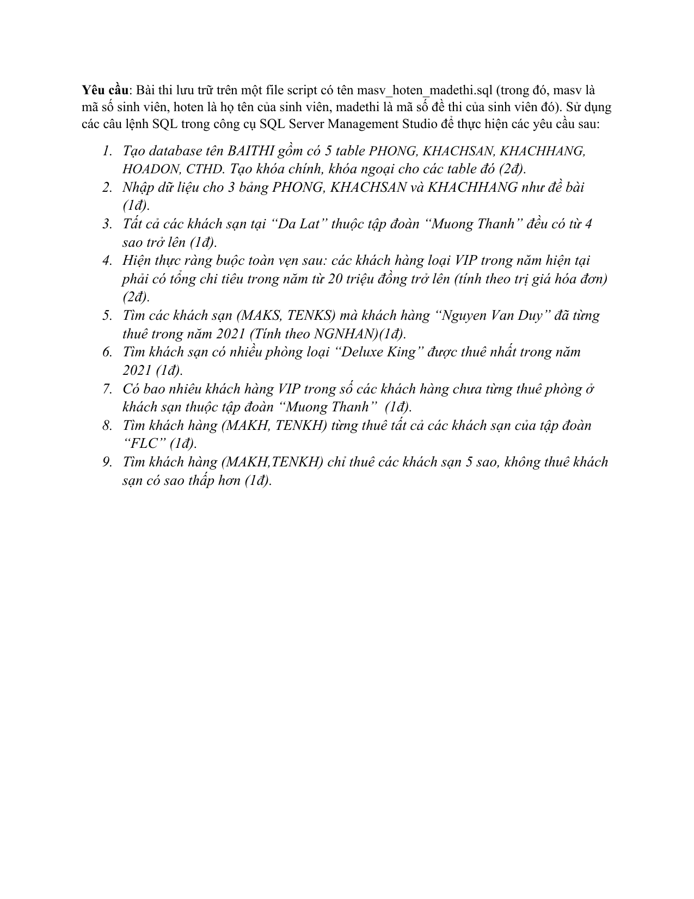

# Đề thi thực hành IT004 — HK1 2021–2022, mã đề 01

- Môn: IT004 — Cơ sở dữ liệu
- Loại: Đề thi thực hành, học kỳ I
- Mã đề: 01
- Thời lượng ghi trên đề: 90 phút
- Số trang: 3
- Nội dung: thiết kế CSDL quản lý đặt phòng khách sạn; SQL Server, khóa, truy vấn và ràng buộc toàn vẹn.
- Nguồn bản gốc: `tai-lieu-lop/HK1 2022-2023/2. Thực Hành/ThiTH/SQL_De_01_2021_2022.pdf` (không đưa PDF vào repo; chỉ lưu ảnh trang để ôn).

## Ảnh đề

