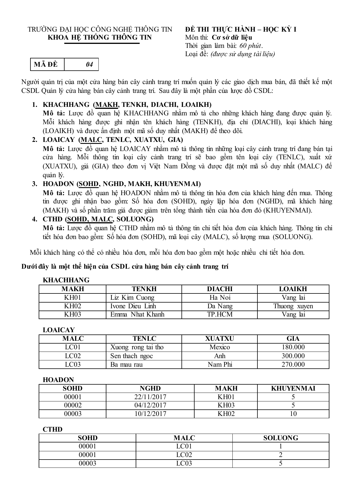
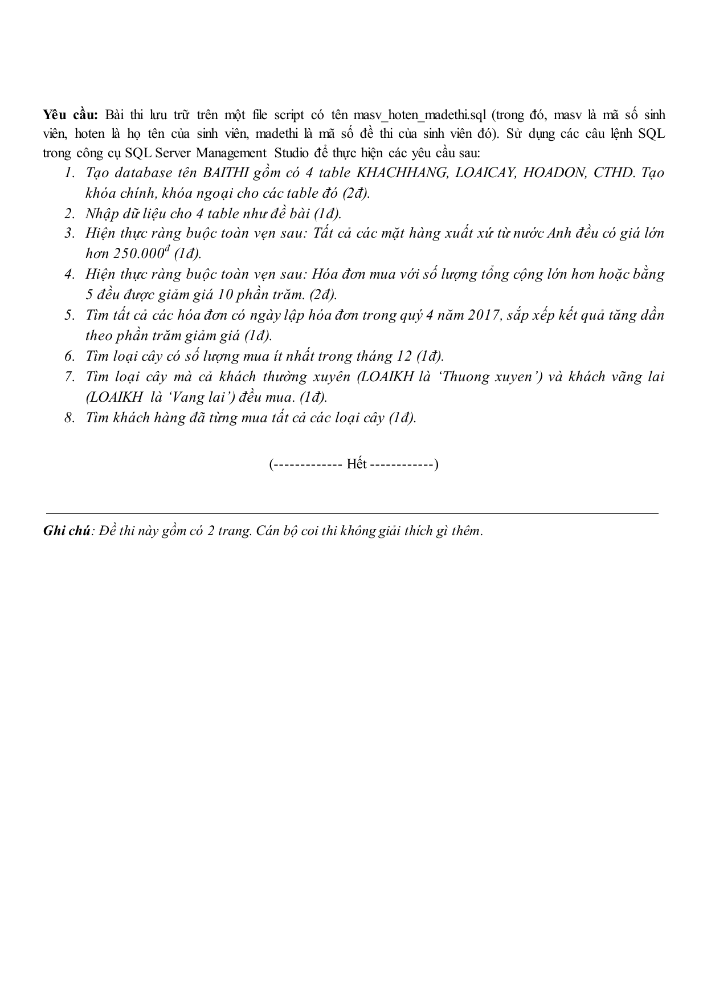

# Đề thi thực hành IT004 — HK1 2017–2018, mã đề 04

- Môn: IT004 — Cơ sở dữ liệu
- Loại: Đề thi thực hành, học kỳ I
- Mã đề: 04
- Thời lượng ghi trên đề: 60 phút
- Số trang: 2
- Nội dung: CSDL quản lý cửa hàng cây cảnh; thiết kế lược đồ, SQL và truy vấn.
- Nguồn bản gốc: `tai-lieu-lop/HK1 2022-2023/2. Thực Hành/Lab05/TH-CSDL_De04_HK1_17-18.pdf` (không đưa PDF vào repo; chỉ lưu ảnh trang để ôn).

## Ảnh đề

