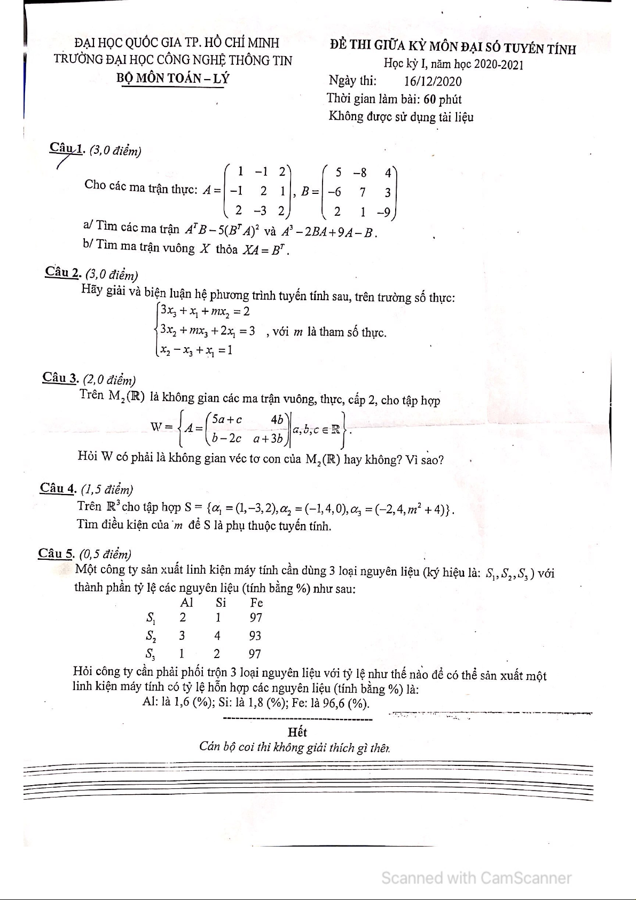

# Đề thi giữa kỳ Đại số tuyến tính — 2020–2021

- Môn: MA003 — Đại số tuyến tính
- Loại: Giữa kỳ
- Năm học: 2020–2021 (theo tên tài liệu Studocu)
- Số ảnh scan lấy được từ trang đang hiển thị: 1
- Nguồn: [Studocu](https://www.studocu.vn/vn/document/truong-dai-hoc-cong-nghe-thong-tin-dai-hoc-quoc-gia-thanh-pho-ho-chi-minh/dai-so-tuyen-tinh/dai-hqc-2020-2021-giua-ky-mon-dai-so-tuyen-tinh/146270995)

## Ảnh đề

Ảnh lưu từ tài nguyên scan được trang tài liệu tải và hiển thị công khai; không dùng extension để bỏ lớp làm mờ hoặc mở trang Premium.
