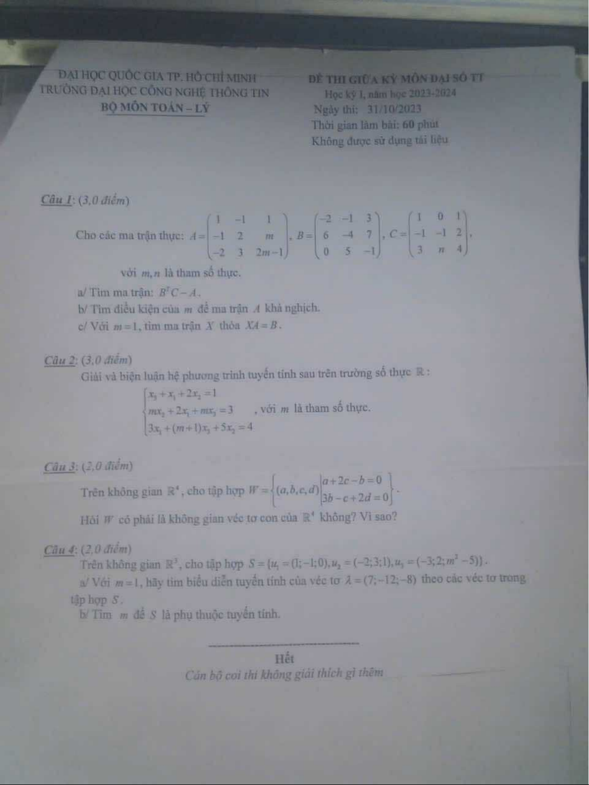

# Đề thi giữa kỳ MA003 — HK1 2023–2024

- Môn: Đại số tuyến tính (MA003)
- Loại: Đề giữa kỳ, học kỳ I
- Ngày ghi trên đề: 31/10/2023
- Số trang theo ảnh: 1
- Nguồn: [Studocu, tài liệu 144361915](https://www.studocu.vn/vn/document/truong-dai-hoc-cong-nghe-thong-tin-dai-hoc-quoc-gia-thanh-pho-ho-chi-minh/dai-so-tuyen-tinh/dai-hqc-cong-nghe-thong-tin-de-thi-giua-ky-mon-dai-2023-2024/144361915)
- Ghi chú: Ảnh scan được hiển thị trực tiếp trong preview công khai. Ảnh hơi mờ do bản chụp gốc; kiểm tra lại ký hiệu trước khi dùng để giải.

## Trang đề

